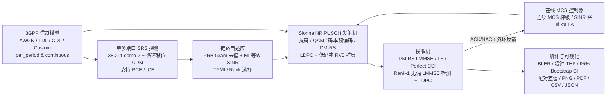

<div align="center">

# 5G NR PUSCH Link-Level Simulation Baseline

**基于 Sionna 1.2.2 的 5G NR CP-OFDM 上行链路级仿真基线平台**

[](pyproject.toml)
[](requirements.txt)
[](https://www.3gpp.org/dynareport/38211.htm)
[](#信道时间演化模式与信道预测接口)
[](#运行单元测试)

<p>
  <a href="#仿真效果示例">仿真效果示例</a> •
  <a href="#核心能力与系统架构">核心架构</a> •
  <a href="#环境安装">环境安装</a> •
  <a href="#快速上手">快速上手</a> •
  <a href="#信道时间演化模式与信道预测接口">信道预测接口</a> •
  <a href="#目录结构">目录结构</a> •
  <a href="#内置配置与物理口径">配置与口径</a>
</p>

</div>

---

面向 **4T64R 上行码本预编码**、**SRS / DM-RS 信道估计对比（ICE vs RCE）**、**跨周期连续时变信道预测**以及 **MCS 表 1 全档位 BLER 瀑布图**的纯 Python 5G NR PUSCH 链路级仿真平台。所有核心链路基于 Sionna 1.2.2 原生物理层模块构建，支持跨 SNR、跨码本、跨估计器的**严格配对信道轨迹**与 95% Bootstrap 置信区间统计。

---

## 仿真效果示例

以下两张示例图均在 **4T64R CDL-C、48 PRB（30 kHz SCS）、`DSUDD` TDD、6.7 GHz、3 km/h、Rank 1 全码本（TPMI 0–27）、满功率模式（`full_power`）** 下，开启 **`--channel-evolution continuous`（跨 SRS 周期连续信道演化）** 直接运行仓库脚本生成。

### 1. SRS & DM-RS 理想估计（ICE）vs 实际估计（RCE）吞吐量对比

<p align="center">
  
</p>

- **场景设定**：单 4 端口循环移位 SRS 资源（comb-2、4 连续重复符号、循环移位 `0/2/4/6`）+ Rank-1 可分离时频 DM-RS LMMSE，目标 BLER 10%，连续演化轨迹含 240 预热 TB + 300 评估 TB（总时长约 1.35 s）。
- **直观结论**：四条曲线在低 SNR 区呈清晰分层——在 −26 dB 处，全理想估计（`SRS ICE + DMRS ICE`，2.125 Mbps）较全实际估计（`SRS RCE + DMRS RCE`，1.667 Mbps）高出 **0.459 Mbps**，其中 DM-RS 估计误差贡献约 **0.299 Mbps**、SRS 估计误差贡献约 **0.144 Mbps**；随 SNR 升高，四条曲线逐步收敛并在 −4 dB 起共同达到 MCS 28 饱和吞吐量 **15.179 Mbps**。

| 参考 SNR | SRS ICE + DMRS ICE | SRS RCE + DMRS ICE | SRS ICE + DMRS RCE | SRS RCE + DMRS RCE |
| :---: | :---: | :---: | :---: | :---: |
| **−26 dB** | 2.125 Mbps *(11.3%)* | 1.982 Mbps *(12.0%)* | 1.826 Mbps *(11.3%)* | 1.667 Mbps *(12.7%)* |
| **−20 dB** | 4.845 Mbps *(11.3%)* | 4.802 Mbps *(11.3%)* | 4.639 Mbps *(11.3%)* | 4.583 Mbps *(11.3%)* |
| **−12 dB** | 10.143 Mbps *(11.3%)* | 10.141 Mbps *(11.3%)* | 9.953 Mbps *(11.3%)* | 10.006 Mbps *(11.0%)* |
| **−4 / 0 dB** | 15.179 Mbps *(0.0%)* | 15.179 Mbps *(0.0%)* | 15.179 Mbps *(0.0%)* | 15.179 Mbps *(0.0%)* |

<details>
<summary>点击展开：复现该图的完整命令</summary>

```bash
python run_ice_rce.py \
  --config pusch_baseline/configs/cdl_c_4t64r_codebooks_long.json \
  --warmup-tb 240 --num-tb 300 \
  --channel-evolution continuous \
  --workers 8
```

</details>

---

### 2. MCS 表 1 全档位（MCS 0–28）BLER 瀑布图

<p align="center">
  
</p>

- **场景设定**：逐档固定 MCS 0–28（覆盖 QPSK / 16-QAM / 64-QAM），在共享连续物理信道库上测量每点 **512 个连续 TB**（约 1.28 s 连续轨迹），启用 `--snr-step 0.25` 亚 dB 自适应加密（全表共实测 420 个 `(MCS, SNR)` 采样点），使用含噪单 4 端口 SRS 选择 TPMI + DM-RS LMMSE 估计，并标注每档首个零错块点的 95% 二项上界（$5.8\times 10^{-3}$，倒三角标记）。
- **直观结论**：29 档曲线沿 SNR 平滑且单调有序排布，完整垂落至 $10^{-2}$ 乃至 $2\times 10^{-3}$ 量级（全部 29 档最低非零 BLER 均 $\le 2.7\%$），覆盖 −28.0 dB 到 −5.5 dB 超过 **22 dB** 的动态范围；得益于可分离时频 DM-RS LMMSE 消除幅度压缩，QPSK 顶档（MCS 9）与 16-QAM 首档（MCS 10）在 10% BLER 处仅相隔 **0.20 dB**，无传统 LS 估计常见的跨调制阶数反转。

| 代表档位 | 调制方式 | TBS (bits) | 10% BLER 对应参考 SNR |
| :---: | :---: | :---: | :---: |
| **MCS 0 / 5 / 9** | QPSK | 1,672 / 5,120 / 9,224 | −27.95 / −24.37 / −20.84 dB |
| **MCS 10 / 16** | 16-QAM | 9,224 / 17,928 | −20.64 / −15.79 dB |
| **MCS 17 / 24 / 28** | 64-QAM | 17,928 / 31,240 / 37,896 | −15.18 / −9.11 / −5.52 dB |

<details>
<summary>点击展开：复现该图的完整命令（支持断点续算与亚 dB 自适应加密）</summary>

```bash
python run_mcs_waterfall.py \
  --num-tb 512 \
  --snr-step 0.25 \
  --channel-evolution continuous \
  --workers 16
```

</details>

---

## 核心能力与系统架构



| 模块 | 关键实现 |
| :--- | :--- |
| **标准 NR PUSCH 物理层** | Sionna 1.2.2 原生发射/接收链路（扰码、QAM、层映射、Type-I 码本预编码、DM-RS、20 迭代 LDPC），并内置低码率 RV0 速率匹配扩展（覆盖 MCS 表 1 全部 0–28 档，低码率编码比特已与 MATLAB 5G Toolbox `nrULSCH` 逐比特校验一致）。 |
| **单多端口循环移位 SRS** | 对齐 3GPP TS 38.211 §6.4.1.4 与 TS 38.214 §6.1.1.1：1/2/4 发射端口复用单个 SRS 资源、占 1/2/4 个连续重复符号、comb-2、$B_{\text{SRS}}=0$、无跳频，通过正交循环移位（`0` / `0,4` / `0,2,4,6`）同时发射并按 $1/\sqrt{N_{\text{ap}}}$ 等分功率；支持实际估计（RCE）与理想估计（ICE）。 |
| **DM-RS 估计与 Rank-1 检测** | 支持可分离时频 **DM-RS LMMSE**（指数功率时延谱 + Jakes 多普勒先验，解决高阶 QAM 幅度压缩）、Sionna 原生 LS 与理想 CSI；Rank-1 大规模阵列采用无偏 `RankOneDetector`。 |
| **跨周期连续信道演化** | 内置 `ContinuousCir` 解析时变采样器，按精确 OFDM 符号索引 `slot * 14 + sym` 在单条 CDL/TDL/自定义轨迹上无缝推进（含预热→评估），内存 $O(1)$，专用于信道预测与移动跟踪算法评估。 |
| **严格配对与统计推断** | 跨 SNR、跨码本、跨估计器模式共享完全一致的物理 CIR 与标准化 SRS 噪声；基于评估期 SRS 周期重采样输出 95% Bootstrap 吞吐量置信区间与两两配对差值。 |

---

## 环境安装

需要 **Python 3.10 或 3.11**（与 TensorFlow 2.19 / Sionna 1.2.2 兼容）。推荐使用独立的 Conda 或 `venv` 环境：

```bash
# 1. 克隆仓库
git clone https://github.com/zhangzij15/nr-pusch-baseline.git
cd nr-pusch-baseline

# 2. 创建并激活虚拟环境（以 conda 为例）
conda create -n pusch_baseline python=3.10 -y
conda activate pusch_baseline

# 3. 安装固定版本依赖（仅含 PHY/SYS 的 sionna-no-rt）
pip install -r requirements.txt

# 4. 可选：以可编辑模式安装，注册 pusch-baseline 命令行入口
pip install -e . --no-deps
```

> [!TIP]
> **纯 Python 运行，无 MATLAB 依赖，CPU 多核即开即跑。** 所有入口脚本都会根据 `--workers` 自动设置 TensorFlow 与 BLAS 线程数，避免多进程并行时 CPU 过度竞争。

---

## 快速上手

所有命令均在**仓库根目录**执行。输出默认写入带时间戳的新目录（位于 `pusch_baseline/results/`，不会覆盖已有结果），包含高清图表、扁平 CSV 与完整无损 `summary.json`。

| 目标任务 | 入口脚本 | 主要产出 |
| :--- | :--- | :--- |
| 快速验证环境是否就绪 | `python -m pusch_baseline` | 冒烟测试（约 5 秒） |
| 三组上行码本对比（Full / Partial / Non-coherent） | `python run_uplink.py` | 吞吐量/BLER 对比图 + 配对差值表 |
| SRS / DM-RS 的 ICE vs RCE 四曲线对比 | `python run_ice_rce.py` | 含低 SNR 放大图的 THP/BLER 对比图 |
| MCS 表 1（0–28）全档位 BLER 瀑布图 | `python run_mcs_waterfall.py` | 29 曲线瀑布图（PNG + PDF，支持断点续算） |

> [!NOTE]
> 当 `--snr` 或 `--snr-db` 以负数开头时，请使用等号连接（例如 `--snr=-16,-8,0`），避免命令行解析器将负号误判为选项标志。

### 1. 环境冒烟测试（约 5 秒）

```bash
python -m pusch_baseline --snr=-25,25 --num-tb 4 --batch-size 2
```

### 2. 三组上行码本对比（`run_uplink.py`）

默认加载 [cdl_c_4t64r_codebooks.json](pusch_baseline/configs/cdl_c_4t64r_codebooks.json)（4T64R CDL-C、48 PRB、`DSUDD`、Rank 1、目标 BLER 10%），在共享信道上同步评估 **Full（TPMI 0–27）**、**Partial + Non-coherent（TPMI 0–11）** 与 **Non-coherent only（TPMI 0–3）**：

```bash
# 快速预览
python run_uplink.py --snr=-16,-8,0 --warmup-tb 30 --num-tb 20

# 默认配置并行运行
python run_uplink.py --workers 4

# 跨 SRS 周期连续信道演化模式
python run_uplink.py --snr=-16,-8,0 --warmup-tb 100 --num-tb 200 --workers 3 \
  --channel-evolution continuous

# 敏感性分析：随机 UE 方位角 + Rel-15 逐端口功率上限（per_port）
python run_uplink.py --snr=-16,-8,0 --warmup-tb 200 --num-tb 240 --workers 3 \
  --ue-yaw-offsets=0,30,60,90,120,150,180,210,240,270,300,330 \
  --tx-power-mode per_port
```

### 3. SRS / DM-RS 的 ICE vs RCE 四曲线对比（`run_ice_rce.py`）

```bash
# 快速运行（连续演化模式）
python run_ice_rce.py --snr=-26,-20,-12,-4 --warmup-tb 60 --num-tb 60 \
  --channel-evolution continuous --workers 4

# 完整 10 点高精度扫频（示例图 1 同款命令）
python run_ice_rce.py --config pusch_baseline/configs/cdl_c_4t64r_codebooks_long.json \
  --warmup-tb 240 --num-tb 300 --channel-evolution continuous --workers 8
```

### 4. MCS 表 1 BLER 瀑布图（`run_mcs_waterfall.py`）

支持按档位断点续算（中断后用相同的 `--output-dir` 与参数重跑即可跳过已完成档位），并支持通过 `--snr-step`（`1` / `0.5` / `0.25` / `0.125` dB）在瀑布陡峭下降区自动亚 dB 加密：

```bash
# 快速 29 档瀑布图（1 dB 步长）
python run_mcs_waterfall.py --num-tb 128 --channel-evolution continuous --workers 8

# 高精度平滑 29 档瀑布图（512 TB + 0.25 dB 自适应加密，示例图 2 同款命令）
python run_mcs_waterfall.py --num-tb 512 --snr-step 0.25 --channel-evolution continuous --workers 16

# 仅测量局部 MCS 档位与指定估计器（ls / lmmse / perfect）
python run_mcs_waterfall.py --mcs 9,10 --estimator lmmse \
  --snr-db=-25,-23,-21,-19,-17,-15 --num-tb 128 --workers 2 \
  --output-dir pusch_baseline/results/dmrs_lmmse_check
```

### 5. 单场景命令行（`python -m pusch_baseline`）

```bash
# 校验配置文件合法性（不执行仿真）
python -m pusch_baseline --config pusch_baseline/configs/cdl_c_4t64r.json --check

# TDL 2T2R 两层固定授权场景，仅保存 THP 图
python -m pusch_baseline --config pusch_baseline/configs/tdl_2x2.json --metric thp

# TDD DSUDD 门限自适应快速测试
python -m pusch_baseline --config pusch_baseline/configs/cdl_c_4t64r_dsudd.json --snr=0 --num-tb 5
```

---

## 信道时间演化模式与信道预测接口

通过 `adaptation.channel_evolution`（或 CLI 参数 `--channel-evolution`）可在两种物理信道采样模式间一键切换：

| 模式 | 物理行为 | 内存开销 | 适用场景 |
| :--- | :--- | :---: | :--- |
| **`per_period`**（默认） | 每个 SRS 周期独立重抽小尺度衰落，仅在周期内部（SRS → 后续 U 槽）保持多普勒连续 | $O(1)$ | 快速遍历统计分布、对比码本/估计器长期均值 |
| **`continuous`** | 整条仿真在单一 CDL / TDL / 自定义 CIR 轨迹上按精确 OFDM 符号时刻连续演进，跨 SRS 周期及预热→评估无缝衔接 | $O(1)$ | **信道预测（CSI Prediction）**、时变跟踪、移动性鲁棒性评估 |

### 直接抽取连续 SRS 观测与真实 PUSCH 信道序列

如需为 AI/传统信道预测算法构造连续时间序列，可直接调用 `SoundingChannel`（底层 `ContinuousCir` 按需解析计算任意符号时刻，超长序列也不会爆内存）：

```python
from dataclasses import replace
import numpy as np
from pusch_baseline import load_config
from pusch_baseline.adaptive_simulation import SoundingChannel, _sounding_epochs
from pusch_baseline.srs import SrsEstimator

cfg = load_config("pusch_baseline/configs/cdl_c_4t64r_codebooks.json")
cfg = replace(cfg, adaptation=replace(cfg.adaptation, channel_evolution="continuous"))
srs = SrsEstimator(4, cfg.carrier.n_size_grid, cfg.adaptation.srs_sequence_id, start_symbol=10)
stream = SoundingChannel(cfg, None, srs)
rng = np.random.default_rng(cfg.sweep.seed)

for epoch in _sounding_epochs(cfg.adaptation, tb_limit=20):
    srs_slot = epoch[0]
    slots = stream.slots(tuple(s - srs_slot for s in epoch), start_slot=srs_slot)
    pilots = np.asarray(next(slots))                             # [RX, TX, 4, M_pilot]
    h_srs_hat = srs.estimate_from_pilots(pilots, 10.0, rng)      # [K, RX, TX] 噪声 SRS 估计
    h_pusch_true = [np.asarray(h) for h in slots]                # 后续各 U 槽真实频域信道
```

### Python 编程调用与自定义信道模型

```python
from dataclasses import replace
from pusch_baseline import load_config, simulate
from pusch_baseline.outputs import write_results

cfg = load_config("pusch_baseline/configs/cdl_c_4t64r_codebooks.json")
cfg = replace(
    cfg,
    sweep=replace(cfg.sweep, snr_db=(-16.0, -8.0), num_tb_per_snr=40),
    adaptation=replace(cfg.adaptation, channel_evolution="continuous"),
)
run = simulate(cfg)
write_results("results/custom_run", **run, metric="both")
```

如需接入外部 CIR 信道模型，将 `channel.kind` 设为 `"custom"`，并向 `simulate` 传入 `channel_model_factory(cfg, resource_grid)`。工厂返回的可调用对象接收 `(batch_size, num_time_steps, sampling_frequency)`，返回复数路径增益 `a[B, 1, R, 1, T, P, S]` 与秒级时延 `tau[B, 1, 1, P]`（或逐天线对时延）。

---

## 目录结构

```text
.
├── run_uplink.py                 # 一键入口：三组码本对比（支持 --single / --workers / --channel-evolution）
├── run_ice_rce.py                # 一键入口：SRS/DMRS × ICE/RCE 四曲线对比
├── run_mcs_waterfall.py          # 一键入口：MCS 表 1 全档位 BLER 瀑布图（支持断点续算）
├── requirements.txt              # 固定版本依赖清单
├── pyproject.toml                # Python 包元信息与 CLI 入口
├── docs/
│   └── figures/                  # README 示例图（两张精选连续信道仿真图）
└── pusch_baseline/
    ├── __init__.py               # 公共导出：SimulationConfig, load_config, simulate, simulate_codebook_comparison
    ├── __main__.py               # 单场景 CLI（python -m pusch_baseline）
    ├── config.py                 # 冻结 dataclass 配置定义与严格校验
    ├── link.py                   # 单 UE PUSCH 链路封装（发射、信道、估计器、检测器、译码器）
    ├── simulation.py             # 固定授权扫频与三码本对比总控
    ├── adaptive_simulation.py    # TDD 时隙轴、SRS 周期、配对扫频与在线 OLLA/MCS 仿真引擎
    ├── continuous_channel.py     # 跨 SRS 周期连续时间演化 CIR 采样器（与 Sionna CDL/TDL 严格一致）
    ├── srs.py                    # 38.211 单多端口循环移位 SRS 序列生成与正交解扩估计
    ├── adaptation.py             # 基于 SRS 的 PRB Gram 去偏、MI 等效 SINR 计算与授权选择
    ├── dmrs_lmmse.py             # Rank 1 可分离时频 DM-RS LMMSE 信道估计器
    ├── rank_one_detector.py      # Rank 1 无偏 LMMSE 检测与 max-log 软解调
    ├── low_rate_tb.py            # 低码率 QPSK RV0 速率匹配与 LDPC 编解码扩展
    ├── olla.py                   # 在线连续 MCS 状态控制器与 SINR 裕量 OLLA 控制器
    ├── mcs_stability.py          # 三窗口 MCS 漂移与合并 BLER 稳定性判定
    ├── throughput_statistics.py  # 基于 SRS 周期的 95% Bootstrap 置信区间与配对差值
    ├── outputs.py                # 单场景结果写入（JSON/CSV/PNG）
    ├── comparison_outputs.py     # 三码本对比结果写入与绘图
    ├── mcs_waterfall_channel.py  # 瀑布图共享物理信道库生成（memmap + SHA-256 指纹）
    ├── mcs_waterfall.py          # 固定 MCS 曲线自适应加密采样
    ├── mcs_waterfall_plot.py     # 瀑布图绘制（PNG + PDF）
    ├── configs/                  # 7 套内置 JSON 场景配置
    └── tests/                    # 86 项纯 Python 单元测试
```

---

## 内置配置与物理口径

### 内置配置文件

| 配置文件 | 场景说明 |
| :--- | :--- |
| [awgn_siso.json](pusch_baseline/configs/awgn_siso.json) | 1T1R AWGN、24 PRB、固定 MCS 5（默认单场景配置） |
| [tdl_2x2.json](pusch_baseline/configs/tdl_2x2.json) | 2T2R TDL-C、Rank 2 码本预编码、30 km/h |
| [cdl_c_4t64r.json](pusch_baseline/configs/cdl_c_4t64r.json) | 4T64R CDL-C、51 PRB、6.7 GHz、3 km/h、固定 Rank 1 授权 |
| [cdl_c_4t64r_adaptive.json](pusch_baseline/configs/cdl_c_4t64r_adaptive.json) | 4T64R CDL-C、周期 SRS + 门限式 Rank/TPMI/MCS 自适应 |
| [cdl_c_4t64r_dsudd.json](pusch_baseline/configs/cdl_c_4t64r_dsudd.json) | 4T64R CDL-C、48 PRB、`DSUDD` TDD 图样 + 门限自适应 |
| [cdl_c_4t64r_codebooks.json](pusch_baseline/configs/cdl_c_4t64r_codebooks.json) | **主对比配置**：4T64R CDL-C、`DSUDD`、DM-RS LMMSE、在线 MCS 梯级（100 预热 + 100 评估 TB） |
| [cdl_c_4t64r_codebooks_long.json](pusch_baseline/configs/cdl_c_4t64r_codebooks_long.json) | **高精度长扫点配置**：500 预热 + 600 评估 TB，开启三窗口 MCS 稳定性检验与信道指纹 |

<details>
<summary>点击展开：JSON 配置核心字段一览（严格校验，省略字段自动使用默认值）</summary>

| 配置节 | 关键字段与说明（详见 [config.py](pusch_baseline/config.py)） |
| :--- | :--- |
| `carrier` | `subcarrier_spacing_khz`（15/30/60/120）、`n_size_grid`（连续分配 PRB 数，1–275）、`cell_id`、`slot_number` |
| `pusch` | `num_antenna_ports`（1/2/4）、`rank`（1–4）、`precoding`（`codebook`/`non-codebook`）、`tpmi`、`mcs_table`（1/2/3）、`mcs_index`、`mapping_type`（A/B）、`symbol_allocation`、`dmrs` |
| `channel` | `kind`（`awgn`/`tdl`/`cdl`/`custom`）、`profile`（A–E）、`delay_spread_ns`、`carrier_frequency_ghz`、`ue_speed_kmh`、`estimator`（`lmmse`/`ls`/`perfect`）、`normalize`、`ue_panel`、`bs_panel`、`ue_yaw_offsets_deg` |
| `sweep` | `snr_db`、`num_tb_per_snr`、`batch_size`（固定授权用）、`seed`、`target_block_errors`、`min_tb_per_snr`、`ul_duty_cycle` |
| `adaptation` | `tdd_pattern`（如 `DSUDD`）、`srs_period_slots`、`srs_start_symbol`、`srs_sequence_id`、`srs_estimator`（`real`/`perfect`）、`channel_evolution`（`per_period`/`continuous`）、`tx_power_mode`（`full_power`/`per_port`）、`rank_tpmi_candidates`、`mcs_indices`、`mcs_thresholds_db`、`sinr_margin_db`、`olla` |
| `adaptation.olla` | `control`（`mcs_index`/`sinr_margin`）、`mcs_axis`（`ladder`/`index`）、`target_bler`、`tolerance`、`warmup_tb`、`window_tb`、`step_mcs`、`max_mcs_spread` |

</details>

### 关键物理口径与输出文件

- **参考 SNR**：定义为单位 UE 名义发射数据 RE 功率预算（预编码与信道之前）与每根接收天线单个复数 RE 加性噪声方差之比，即 $\sigma_n^2 = 10^{-\text{SNR}_{\text{dB}}/10}$。64 接收天线带来约 18 dB 阵列合并增益，叠加 38.901 阵元方向图增益后，有效工作区间位于负参考 SNR。
- **发射功率模式**：
  - `full_power`（默认）：PUSCH 按 $1/\|W\|_F$ 归一化，所有 TPMI 总数据 RE 功率均为 1（对应 Rel-16 满功率能力）。
  - `per_port`：限制每个物理发射端口数据 RE 平均功率不超过 $1/N_{\text{TX}}$（对应 Rel-15 均分功放预算；4 端口 Rank 1 非相干/部分相干/全相干总功率分别为 0.25 / 0.5 / 1.0）。
  - 两种模式下，单 $N_{\text{TX}}$ 端口 SRS 资源均由全部端口同时发射，每端口活跃 RE 功率为 $1/N_{\text{TX}}$、全端口合计为 1。
- **BLER 与吞吐量**：CRC 校验失败或译码比特与原始发射比特不一致均计为错块；TDD 墙钟吞吐量 `thp_wall_clock_mbps` 为正确译码净荷比特数除以包含全部 `D`、`S`、`U` 及空闲时隙在内的总物理时长（Mbps，无 HARQ 首传净吞吐量）。
- **输出产物**：`THP_vs_SNR*.png` / `BLER_vs_SNR*.png`（及瀑布图 `.pdf`）、`results.csv`、`paired_differences.csv` / `throughput_differences.csv`、`summary.json`（含完整配置、逐 TTI 轨迹和信道 SHA-256 指纹）。

---

## 运行单元测试

```bash
python -m unittest discover -s pusch_baseline/tests -v
```

全部 **86 项单元测试**（覆盖单多端口循环移位 SRS 正交性、与 Sionna 原生轨迹位级一致的 `ContinuousCir`、DM-RS LMMSE、低码率 RV0 编解码、在线 OLLA、三窗口稳定性、亚 dB 瀑布图网格/断点续算及 ICE/RCE 输出）均可在纯 Python 环境中独立运行。

---

## 常见问题（FAQ）

<details>
<summary><b>Q1：是否需要安装 MATLAB 或 CUDA GPU？</b></summary>

不需要。所有仿真脚本与 86 项单元测试均为纯 Python 运行，不依赖 MATLAB 工具箱；在无 GPU 的多核 CPU 机器上即可运行，通过 `--workers N` 即可自动分配多进程与 TensorFlow/BLAS 线程。

</details>

<details>
<summary><b>Q2：为什么默认 4T64R 场景的工作 SNR 是负值（例如 −26 dB ~ −4 dB）？</b></summary>

本平台的参考 SNR 定义为「单数据 RE 发射总功率预算 / 单根接收天线单 RE 噪声方差」，不含接收阵列合并增益与阵元方向图增益。64 接收天线带来约 18 dB 的 MRC 阵列合并增益，叠加 3GPP TR 38.901 阵元方向图增益后，接收端等效后处理 SINR 仍落在 0 ~ 25 dB 的标准解调区间。

</details>

<details>
<summary><b>Q3：长时瀑布图仿真中途被中断怎么办？</b></summary>

`run_mcs_waterfall.py` 会在输出目录内逐 `(MCS, SNR)` 点写入原子检查点（`mcs_checkpoints/`）。只需使用**完全相同的 `--output-dir` 和命令参数**重新运行，脚本会自动校验配置与共享信道库指纹并跳过已完成的点。

</details>

<details>
<summary><b>Q4：如何快速接入自己的信道预测或链路自适应算法？</b></summary>

- **离线/在线评估信道预测**：使用 `adaptation.channel_evolution = "continuous"` + `SoundingChannel`（见上方[信道预测接口](#信道时间演化模式与信道预测接口)），即可按精确 OFDM 符号时刻连续读取噪声 SRS 估计与后续真实 PUSCH 频响。
- **接入自定义信道模型**：将 `channel.kind` 设为 `"custom"` 并向 `simulate()` 传入 `channel_model_factory`，同时兼容 `per_period` 与 `continuous` 两种模式。

</details>

---

## 建模范围与参考标准

- **覆盖范围**：单 UE、连续频域 PRB 分配、常规 CP、符号 0 起始的 Mapping Type A/B、CP-OFDM、单 TB/调度时隙、首传净吞吐量。
- **范围之外**：DFT-s-OFDM、跳频、HARQ 软合并、UCI 复用、多用户 MIMO 调度、大尺度路损/阴影衰落、射频损伤。
- **统计提示**：在 `channel_evolution="continuous"` 模式下，相邻 SRS 周期存在时间相关，按 SRS 周期重采样的 95% bootstrap 区间反映的是当前连续轨迹上的观测波动；两种模式下均假设 SRS 探测结果在下一个 `U` 槽前送达（未额外建模 $K_2/N_2$ 调度时延）。
- **参考标准**：[3GPP TS 38.211](https://www.3gpp.org/dynareport/38211.htm) · [TS 38.212](https://www.3gpp.org/dynareport/38212.htm) · [TS 38.213](https://www.3gpp.org/dynareport/38213.htm) · [TS 38.214](https://www.3gpp.org/dynareport/38214.htm) · [TR 38.901](https://www.3gpp.org/dynareport/38901.htm) · [Sionna 1.2.2 PUSCH 教程](https://nvlabs.github.io/sionna/v1.2.2/phy/tutorials/5G_NR_PUSCH.html)。
