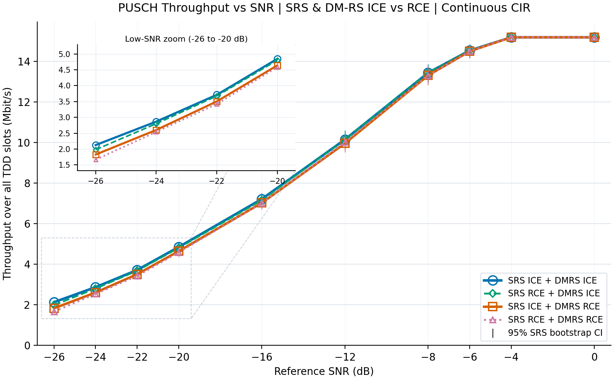
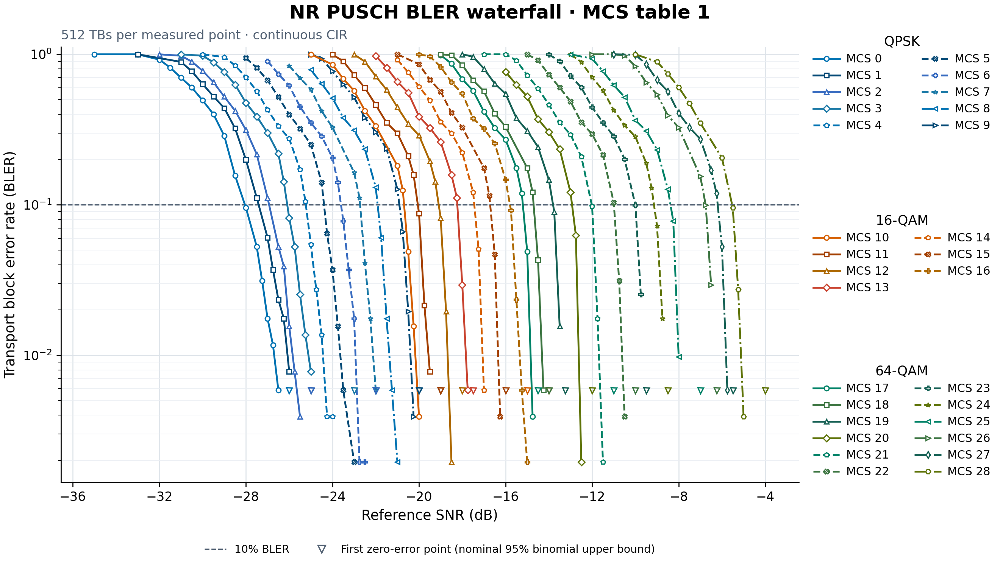
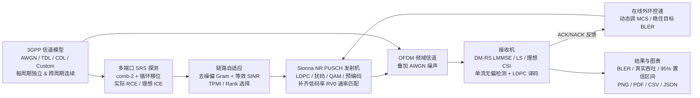

<div align="center">

# 5G NR PUSCH Link-Level Simulation Baseline

**基于 Sionna 1.2.2 的 5G NR 上行（PUSCH）链路级仿真基线**

**简体中文** | [English](README_EN.md)

[](https://github.com/zhangzij15/nr-pusch-baseline/actions/workflows/ci.yml)
[](pyproject.toml)
[](requirements.txt)
[](https://www.3gpp.org/dynareport/38211.htm)
[](LICENSE)

<p>
  <a href="#仿真效果示例">仿真效果示例</a> •
  <a href="#核心能力与系统架构">核心架构</a> •
  <a href="#环境安装">环境安装</a> •
  <a href="#快速上手">快速上手</a> •
  <a href="#信道演化模式与信道预测接口">信道预测接口</a> •
  <a href="#目录结构">目录结构</a> •
  <a href="#内置配置与口径说明">配置与口径</a> •
  <a href="#常见问题">常见问题</a> •
  <a href="#引用">引用</a>
</p>

</div>

---

这是一个纯 Python 编写的 **5G NR CP-OFDM 上行（PUSCH）链路级仿真基线**，底层基于 NVIDIA **Sionna 1.2.2**，开箱即用，无需 MATLAB 或 GPU。

如果你正在研究 **4T64R 上行码本预编码**、**SRS / DM-RS 信道估计**、**时变信道预测（CSI Prediction）**，或需要一套标准的 **MCS 0–28 BLER 瀑布图**作基线对照，可以直接使用本仓库开展实验。所有方案对比均在同一批物理信道与噪声实现上严格配对，确保对比公平、结果可复现，并自动输出 95% 吞吐量置信区间与两两差值。

---

## 仿真效果示例

以下两张图均基于 **4T64R CDL-C、48 PRB（30 kHz 子载波间隔）、`DSUDD` TDD、6.7 GHz、3 km/h 步行速度、单流全码本（TPMI 0–27）、满功率模式（`full_power`）**，开启 **`--channel-evolution continuous`（跨周期连续移动信道）** 直接运行仓库脚本生成。

### 1. 理想信道估计（ICE）vs 实际信道估计（RCE）吞吐量对比

<p align="center">
  
</p>

> `ICE` 表示理想信道已知，`RCE` 表示基于导频的实际信道估计。四条曲线将 **SRS（预编码选择）** 与 **DM-RS（数据解调）** 两阶段的估计误差解耦呈现，便于直接定位链路性能瓶颈。

- **仿真配置**：4 根发射天线共用 1 个 SRS 资源（comb-2、4 个连续重复符号、正交循环移位 `0/2/4/6`），在 `DSUDD` 每个 `S` 时隙发送一次（周期 5 时隙 = 2.5 ms）；接收端采用时频可分离 DM-RS LMMSE，外环控速目标 BLER 为 10%。整条连续轨迹含 240 个预热块与 300 个评估块（约 1.35 秒，单次移动场景 `seed=20261112`）。
- **主要现象**：低信噪比下四条曲线层次清晰。在 −26 dB 处，全理想估计（2.125 Mbps）领先全实际估计（1.619 Mbps）**0.507 Mbps**；单开一项实际估计时，DM-RS 误差带来 **0.299 Mbps** 损失，SRS 误差带来 **0.178 Mbps** 损失（均具统计显著性，其余约 0.030 Mbps 来自两项误差叠加）。随着信噪比升高，估计误差逐步收敛，自 −4 dB 起四条曲线共同达到 MCS 28 吞吐上限（**15.179 Mbps**）。

| 参考 SNR | SRS ICE + DMRS ICE | SRS RCE + DMRS ICE | SRS ICE + DMRS RCE | SRS RCE + DMRS RCE |
| :---: | :---: | :---: | :---: | :---: |
| **−26 dB** | 2.125 Mbps *(11.3%)* | 1.947 Mbps *(12.0%)* | 1.826 Mbps *(11.3%)* | 1.619 Mbps *(12.7%)* |
| **−20 dB** | 4.845 Mbps *(11.3%)* | 4.791 Mbps *(11.3%)* | 4.639 Mbps *(11.3%)* | 4.555 Mbps *(11.7%)* |
| **−12 dB** | 10.143 Mbps *(11.3%)* | 10.143 Mbps *(11.3%)* | 9.953 Mbps *(11.3%)* | 9.953 Mbps *(11.3%)* |
| **−4 / 0 dB** | 15.179 Mbps *(0.0%)* | 15.179 Mbps *(0.0%)* | 15.179 Mbps *(0.0%)* | 15.179 Mbps *(0.0%)* |

> 表中括号内斜体百分比为对应信噪比下的实测评估 BLER（外环目标 10%）；吞吐量为计入全部 TDD 时隙的真实吞吐量（`thp_wall_clock_mbps`）。

<details>
<summary>点击展开：复现该图的完整命令（16 核 CPU 参考耗时约 25 分钟）</summary>

```bash
python run_ice_rce.py --config pusch_baseline/configs/cdl_c_4t64r_codebooks_long.json --warmup-tb 240 --num-tb 300 --channel-evolution continuous --workers 16
```

> 可按本机物理 CPU 核数调整 `--workers`（不影响最终数值）；省略 `--snr` 时默认扫描内置 10 个信噪比点（−26 至 0 dB）。

</details>

---

### 2. MCS 表 1 全档位（MCS 0–28）BLER 瀑布图

<p align="center">
  
</p>

- **仿真配置**：依次固定 MCS 0 至 28（覆盖 QPSK / 16-QAM / 64-QAM），在共享连续信道库上每个采样点评估 **512 个连续传输块**（约 1.28 秒轨迹），并在陡降区间自动二分加密至 `0.25 dB` 步长（全表共实测 429 个点）。预编码由含噪 4 端口 SRS（每 5 时隙一次）选出，解调采用 DM-RS LMMSE。每条曲线首次出现「零错块」的位置以倒三角标出（95% 置信上界约 0.58%）。
- **主要现象**：29 条曲线从 −28.0 dB 平滑排布至 −5.5 dB，总跨度超过 **22 dB**，10% BLER 拐点随 MCS 严格单调递增。每条曲线均完整下降至零错块点，零错块前的最低非零误块率全表不超过 2.9%（多数档位落在 0.2%–1%）。得益于 DM-RS LMMSE 消除了 LS 估计的幅度压缩，QPSK 顶档（MCS 9）与 16-QAM 起步档（MCS 10）在 10% BLER 处仅相隔 **0.22 dB**，避免了调制切换边界处的曲线倒挂。

| 代表档位 | 调制方式 | 传输块大小 (bits) | 10% BLER 对应参考 SNR |
| :---: | :---: | :---: | :---: |
| **MCS 0 / 5 / 9** | QPSK | 1,672 / 5,120 / 9,224 | −28.04 / −24.37 / −20.89 dB |
| **MCS 10 / 16** | 16-QAM | 9,224 / 17,928 | −20.67 / −15.79 dB |
| **MCS 17 / 24 / 28** | 64-QAM | 17,928 / 31,240 / 37,896 | −15.18 / −9.12 / −5.52 dB |

> [!NOTE]
> 以上两张示例图均基于 `seed=20261112` 的单条连续移动信道轨迹。如需多场景统计均值，只需更换多个 `--seed` 重复运行后汇总即可，详见文末[建模范围与参考标准](#建模范围与参考标准)中的统计提示。

<details>
<summary>点击展开：复现该图的完整命令（支持断点续跑，16 核 CPU 参考耗时约 80 分钟）</summary>

```bash
python run_mcs_waterfall.py --num-tb 512 --snr-step 0.25 --channel-evolution continuous --workers 16
```

</details>

---

## 核心能力与系统架构



| 模块 | 核心特性与实现要点 |
| :--- | :--- |
| **标准 NR PUSCH 物理层** | 基于 Sionna 1.2.2 原生上行链路（扰码、QAM、层映射、Type-I 码本预编码、DM-RS、20 迭代 LDPC），并补齐 Sionna 原生不支持的低码率 RV0 速率匹配，固定授权与自适应模式均支持 MCS 表 1/2/3 的低码率档位（含表 1 全部 0–28 档，低码率编码比特已与 MATLAB 5G Toolbox `nrULSCH` 逐比特核对一致）。 |
| **单资源多端口 SRS 探测** | 按 3GPP TS 38.211 / TS 38.214 建模：1/2/4 根发射天线共用 1 个 SRS 资源（comb-2、带宽配置 `B_SRS = 0`、不跳频、占 1/2/4 个连续重复符号），通过正交循环移位（`0` / `0,4` / `0,2,4,6`）区分端口，总发射功率按端口均分（每端口功率为 $1 / N_{\mathrm{ap}}$ ）；支持含噪真实估计（RCE）与理想估计（ICE）一键切换。 |
| **DM-RS 估计与单流检测** | 内置时频可分离的 **DM-RS LMMSE**（结合指数时延扩展与 Jakes 多普勒先验），有效消除传统 LS 估计在高阶 QAM 下的幅度压缩；同时支持原生 LS 与理想 CSI。单流（Rank 1）接收采用无偏 `RankOneDetector`，适配 64R 等大规模接收阵列。 |
| **跨周期连续信道演化** | 除默认的「每 SRS 周期独立刷新小尺度衰落」（适合快速遍历多衰落状态）外，内置 `ContinuousCir` 连续时间采样器：整条仿真（含预热与评估）沿**同一条连续移动的物理轨迹**按精确 OFDM 符号时刻解析推进，内存占用恒定为 $O(1)$ ，专用于评估信道预测与时变跟踪算法。 |
| **公平配对与统计评估** | 同一实验内，不同信噪比、不同码本与不同估计器复用同一批物理信道与噪声种子，剔除随机采样偏差；自动输出吞吐量的 95% SRS 周期 Bootstrap 置信区间及方案两两配对差值。 |

---

## 环境安装

运行环境需 **Python 3.10 或 3.11**（受限于 TensorFlow 2.19 与 Sionna 1.2.2，暂不支持 Python 3.12+）。建议创建独立的 Conda 或 `venv` 环境：

```bash
# 1. 克隆仓库
git clone https://github.com/zhangzij15/nr-pusch-baseline.git
cd nr-pusch-baseline

# 2. 创建并激活环境（以 conda 为例）
conda create -n pusch_baseline python=3.10 -y
conda activate pusch_baseline

# 3. 安装锁定版本的依赖（仅含通信物理层的 sionna-no-rt）
pip install -r requirements.txt

# 4. 可选：以可编辑模式安装，额外注册 pusch-baseline 命令
pip install -e . --no-deps
```

> [!TIP]
> **100% 纯 Python 运行，无需 MATLAB，也不强制 GPU。** 普通多核 CPU 电脑或服务器均可直接运行，脚本会根据 `--workers` 自动配置 TensorFlow 线程池与 BLAS 单线程环境变量，防止多进程互相争抢核心。

---

## 快速上手

以下命令均在**仓库根目录**执行，统一写成单行，Linux / macOS / Windows PowerShell / CMD 均可直接复制运行。每次运行默认新建带 UTC 时间戳的输出目录，**不会覆盖历史结果**：
- `python -m pusch_baseline`（或安装后的 `pusch-baseline`）默认写入 `./results/pusch_<timestamp>/`；
- `run_uplink.py`、`run_ice_rce.py`、`run_mcs_waterfall.py` 默认写入 `pusch_baseline/results/`。

| 实验目标 | 入口脚本 | 主要产物 | 参考耗时（多核 CPU） |
| :--- | :--- | :--- | :---: |
| 环境冒烟 / 单场景仿真 | `python -m pusch_baseline` | BLER / 吞吐曲线 + CSV / JSON | ~5 秒 |
| 三套上行码本对比（Full / Partial / Non-coherent） | `python run_uplink.py` | 三码本对比图 + 配对差值表 | 1–10 分钟 |
| SRS / DM-RS 理想 vs 实际估计（4 曲线） | `python run_ice_rce.py` | 含低 SNR 放大图的 4 曲线对比图 | 2–25 分钟 |
| MCS 表 1 全 29 档 BLER 瀑布图 | `python run_mcs_waterfall.py` | 29 曲线瀑布图（PNG + PDF，可续跑） | 15–80 分钟 |

> [!NOTE]
> 当 `--snr` 或 `--snr-db` 的首个数值为负数时，请务必使用等号连接（例如 `--snr=-16,-8,0`），避免命令行解析器将负号误判为新选项。

### 1. 5 秒环境冒烟测试

```bash
python -m pusch_baseline --snr=-25,25 --num-tb 4 --batch-size 2
```

（若已执行 `pip install -e . --no-deps`，也可直接运行 `pusch-baseline --snr=-25,25 --num-tb 4 --batch-size 2`。）

### 2. 三组上行码本对比（`run_uplink.py`）

默认加载 [cdl_c_4t64r_codebooks.json](pusch_baseline/configs/cdl_c_4t64r_codebooks.json)（4T64R CDL-C、48 PRB、`DSUDD`、单流、目标 BLER 10%），在完全配对的信道上同步对比 **全相干码本（TPMI 0–27）**、**部分 + 非相干（TPMI 0–11）** 和 **仅非相干（TPMI 0–3）**：

```bash
# 快速试跑
python run_uplink.py --snr=-16,-8,0 --warmup-tb 30 --num-tb 20

# 默认配置并行运行（可改 --seed 切换信道场景）
python run_uplink.py --workers 4 --seed 20261112

# 开启跨周期连续信道演化
python run_uplink.py --snr=-16,-8,0 --warmup-tb 100 --num-tb 200 --channel-evolution continuous --workers 3

# 进阶测试：随机终端朝向 + Rel-15 单端口功率上限（per_port）
python run_uplink.py --snr=-16,-8,0 --warmup-tb 200 --num-tb 240 --ue-yaw-offsets=0,30,60,90,120,150,180,210,240,270,300,330 --tx-power-mode per_port --workers 3
```

### 3. SRS / DM-RS 的 ICE vs RCE 四曲线对比（`run_ice_rce.py`）

省略 `--snr` 时，默认扫描内置 10 个信噪比点（`−26, −24, −22, −20, −16, −12, −8, −6, −4, 0 dB`）：

```bash
# 快速运行（连续信道模式，约 2 分钟）
python run_ice_rce.py --snr=-26,-20,-12,-4 --warmup-tb 60 --num-tb 60 --channel-evolution continuous --workers 4

# 完整 10 点高精度扫频（示例图 1 同款命令；16 核 CPU 约 25 分钟）
python run_ice_rce.py --config pusch_baseline/configs/cdl_c_4t64r_codebooks_long.json --warmup-tb 240 --num-tb 300 --channel-evolution continuous --workers 16
```

### 4. MCS 表 1 BLER 瀑布图（`run_mcs_waterfall.py`）

支持逐点断点续跑（中断后使用相同 `--output-dir` 与参数重新运行即可自动续算），并通过 `--snr-step`（可选 `1` / `0.5` / `0.25` / `0.125` dB）在曲线陡降区间自动二分加密：

```bash
# 快速 29 档瀑布图（1 dB 步长）
python run_mcs_waterfall.py --num-tb 128 --channel-evolution continuous --workers 8

# 高精度平滑 29 档瀑布图（512 TB + 0.25 dB 自适应加密，示例图 2 同款命令；16 核 CPU 约 80 分钟）
python run_mcs_waterfall.py --num-tb 512 --snr-step 0.25 --channel-evolution continuous --workers 16

# 只测指定几个 MCS 档位并切换估计器（ls / lmmse / perfect）
python run_mcs_waterfall.py --mcs 9,10 --estimator lmmse --snr-db=-25,-23,-21,-19,-17,-15 --num-tb 128 --workers 2 --output-dir pusch_baseline/results/dmrs_lmmse_check
```

### 5. 单场景命令行（`python -m pusch_baseline`）

```bash
# 只校验配置文件与参数，不执行仿真
python -m pusch_baseline --config pusch_baseline/configs/cdl_c_4t64r.json --check

# TDL 2T2R 双流固定 MCS 场景，仅输出吞吐量曲线
python -m pusch_baseline --config pusch_baseline/configs/tdl_2x2.json --metric thp

# TDD DSUDD 门限式自适应快速试跑
python -m pusch_baseline --config pusch_baseline/configs/cdl_c_4t64r_dsudd.json --snr=0 --num-tb 5

# 长扫点 OLLA 配置快速试跑（自动收缩稳定性窗口，防三窗口校验报错）
python -m pusch_baseline --config pusch_baseline/configs/cdl_c_4t64r_codebooks_long.json --snr=-12 --warmup-tb 30 --num-tb 30
```

<details>
<summary>点击展开：常用命令行参数速查表</summary>

| 参数 | 适用脚本 | 作用 |
| :--- | :--- | :--- |
| `--config PATH` | 全部脚本 | 指定 JSON 场景配置文件 |
| `--output-dir PATH` | 全部脚本 | 指定结果保存目录（除瀑布图续跑外须为新目录） |
| `--snr` / `--snr-db` | 全部脚本 | 覆盖信噪比列表，负数开头需用等号（如 `--snr=-20,-12,-4`） |
| `--num-tb` / `--warmup-tb` | 全部脚本（`--warmup-tb` 限含 OLLA 脚本） | 覆盖评估 / 预热传输块数量；开启 OLLA 稳定性门限时自动收缩统计窗口 |
| `--channel-evolution` | 三个 `run_*.py` | 选择 `per_period`（每周期独立刷新）或 `continuous`（跨周期连续轨迹） |
| `--tx-power-mode` | `run_uplink` / `run_ice_rce` | 选择 `full_power`（Rel-16 满功率）或 `per_port`（Rel-15 单端口功率上限） |
| `--ue-yaw-offsets` | `run_uplink` / `run_ice_rce` | CDL 终端随机方位角偏移列表（单位：度） |
| `--snr-step` / `--snr-from` | `run_mcs_waterfall` | 陡降区自动加密步长（`1/0.5/0.25/0.125`）或复用已有 `summary.json` 网格 |
| `--single` | `run_uplink` | 仅按配置文件自身候选跑单条曲线（不做三码本对比） |
| `--seed INT` | 全部脚本 | 指定随机种子（更换种子可用于多场景统计平均） |
| `--workers INT` | 三个 `run_*.py` | 并行进程数，建议不超过本机物理 CPU 核数 |

</details>

---

## 信道演化模式与信道预测接口

通过配置文件中的 `adaptation.channel_evolution` 或命令行 `--channel-evolution`，可在两种信道演化模式间一键切换：

| 模式 | 信道演化方式 | 内存占用 | 适用场景 |
| :--- | :--- | :---: | :--- |
| **`per_period`**（默认） | 每个 SRS 周期重新采样一次小尺度衰落，仅在单周期内部保持时间连续 | $O(1)$ | 快速遍历多衰落状态，比较算法长期平均性能 |
| **`continuous`** | 整条仿真（含预热到评估）沿同一条连续移动的物理轨迹按符号时刻推进，跨周期无缝衔接 | $O(1)$ | **信道预测（CSI Prediction）**、时变跟踪、移动性评估 |

### 导出连续 SRS 观测与真实 PUSCH 信道（供信道预测使用）

研究 AI 或传统信道预测时，可直接调用 `SoundingChannel` 与 `sounding_epochs` 流式获取连续时间序列。内置 CDL / TDL 按需在任意精确 OFDM 符号时刻解析求值，超长序列也不会产生内存膨胀：

```python
from dataclasses import replace
import numpy as np
from pusch_baseline import load_config
from pusch_baseline.adaptive_simulation import SoundingChannel, sounding_epochs
from pusch_baseline.srs import SrsEstimator

cfg = load_config("pusch_baseline/configs/cdl_c_4t64r_codebooks.json")
cfg = replace(cfg, adaptation=replace(cfg.adaptation, channel_evolution="continuous"))
srs = SrsEstimator(4, cfg.carrier.n_size_grid, cfg.adaptation.srs_sequence_id, start_symbol=10)
epochs = list(sounding_epochs(cfg.adaptation, tb_limit=20))       # DSUDD 下每 5 个时隙发一次 SRS
# total_slots 仅自定义信道需要；内置 CDL/TDL 按需解析，可省略
stream = SoundingChannel(cfg, None, srs, total_slots=epochs[-1][-1] + 1)
rng = np.random.default_rng(cfg.sweep.seed)
snr_db = -10.0
noise_var = 10.0 ** (-snr_db / 10.0)                              # 参考 SNR 对应的每 RE 噪声方差

for epoch in epochs:
    srs_slot = epoch[0]
    # 首项为当前周期 SRS 导频频域响应，后续依次为该周期内各 PUSCH 时隙的完整频域响应
    slots = stream.slots(tuple(s - srs_slot for s in epoch), start_slot=srs_slot)
    pilots = np.asarray(next(slots))                              # [RX, TX, 4, M_pilot]
    h_srs_hat = srs.estimate_from_pilots(pilots, noise_var, rng)  # [K, RX, TX] 含噪 SRS 估计
    h_pusch_true = [np.asarray(h) for h in slots]                 # 每项形状 [1, 1, RX, 1, TX, 14, K]
```

### 在 Python 脚本中调用与接入自定义信道

```python
from dataclasses import replace
from pusch_baseline import load_config, simulate
from pusch_baseline.outputs import write_results

cfg = load_config("pusch_baseline/configs/cdl_c_4t64r_codebooks.json")
cfg = replace(
    cfg,
    sweep=replace(cfg.sweep, snr_db=(-16.0, -8.0), num_tb_per_snr=40),
    adaptation=replace(cfg.adaptation, channel_evolution="continuous"),
)
run = simulate(cfg)
write_results("results/custom_run", **run, metric="both")
```

如需接入射线追踪或实测信道等外部模型，只需将 `channel.kind` 设为 `"custom"`，并在调用 `simulate()` 时传入 `channel_model_factory(cfg, resource_grid)`。工厂返回的可调用对象接收 `(batch_size, num_time_steps, sampling_frequency)`，输出复数路径增益 `a[B, 1, R, 1, T, P, S]` 与秒级时延 `tau[B, 1, 1, P]`（或逐天线对时延），原生兼容 `per_period` 与 `continuous` 两种模式。

---

## 目录结构

```text
.
├── run_uplink.py                 # 入口 1：三组码本对比（支持 --single / --workers / --channel-evolution / --seed）
├── run_ice_rce.py                # 入口 2：SRS/DM-RS × ICE/RCE 四曲线对比
├── run_mcs_waterfall.py          # 入口 3：MCS 表 1 全档位 BLER 瀑布图（支持断点续跑与亚 dB 加密）
├── README.md / README_EN.md      # 中英文说明文档
├── LICENSE                       # MIT 开源许可证
├── CITATION.cff                  # GitHub 学术引用元数据
├── requirements.txt              # 锁定版本的依赖清单
├── pyproject.toml                # Python 包元信息与 CLI 入口
├── .github/workflows/ci.yml      # GitHub Actions 自动测试工作流
├── docs/
│   └── figures/                  # README 示例图（两张精选连续信道仿真图）
└── pusch_baseline/
    ├── __init__.py               # 公共导出：SimulationConfig, load_config, simulate, simulate_codebook_comparison
    ├── __main__.py               # 单场景 CLI（python -m pusch_baseline / pusch-baseline）
    ├── config.py                 # 配置数据类与严格参数校验
    ├── link.py                   # 单 UE PUSCH 收发链路封装
    ├── simulation.py             # 固定授权扫频、三码本对比总控与运行时线程配置
    ├── adaptive_simulation.py    # TDD 时隙轴、SRS 周期调度与外环自适应引擎
    ├── continuous_channel.py     # 跨 SRS 周期连续演化 CIR 采样器（与 Sionna CDL/TDL 严格一致）
    ├── srs.py                    # 38.211 单多端口循环移位 SRS 序列生成与正交解扩估计
    ├── adaptation.py             # 基于 SRS 的去噪偏 Gram 计算与 TPMI/Rank 选择
    ├── dmrs_lmmse.py             # 单流时频可分离 DM-RS LMMSE 信道估计器
    ├── rank_one_detector.py      # 单流无偏 LMMSE 检测与软解调
    ├── low_rate_tb.py            # 低码率 QPSK RV0 速率匹配与 LDPC 扩展
    ├── olla.py                   # 在线 MCS 状态控制器与 SINR 裕量 OLLA 控制器
    ├── mcs_stability.py          # 三窗口 MCS 漂移与 BLER 稳定性检查
    ├── throughput_statistics.py  # 95% Bootstrap 吞吐量置信区间与配对差值计算
    ├── outputs.py                # 单场景结果写出（JSON / CSV / PNG）
    ├── comparison_outputs.py     # 三码本对比结果写出与绘图
    ├── mcs_waterfall_channel.py  # 瀑布图共享物理信道库生成（memmap + SHA-256 指纹）
    ├── mcs_waterfall.py          # 固定 MCS 曲线自适应加密采样
    ├── mcs_waterfall_plot.py     # 瀑布图绘制（PNG + PDF）
    ├── configs/                  # 7 套内置 JSON 场景配置
    └── tests/                    # 纯 Python 单元测试套件
```

---

## 内置配置与口径说明

### 内置配置文件

| 配置文件 | 适用场景 |
| :--- | :--- |
| [awgn_siso.json](pusch_baseline/configs/awgn_siso.json) | 1T1R AWGN、24 PRB、固定 MCS 5（默认冒烟配置） |
| [tdl_2x2.json](pusch_baseline/configs/tdl_2x2.json) | 2T2R TDL-C、双流码本预编码、30 km/h |
| [cdl_c_4t64r.json](pusch_baseline/configs/cdl_c_4t64r.json) | 4T64R CDL-C、51 PRB、6.7 GHz、3 km/h、固定单流授权 |
| [cdl_c_4t64r_adaptive.json](pusch_baseline/configs/cdl_c_4t64r_adaptive.json) | 4T64R CDL-C、周期 SRS + 门限式 Rank/TPMI/MCS 自适应 |
| [cdl_c_4t64r_dsudd.json](pusch_baseline/configs/cdl_c_4t64r_dsudd.json) | 4T64R CDL-C、48 PRB、`DSUDD` TDD 图样 + 门限自适应 |
| [cdl_c_4t64r_codebooks.json](pusch_baseline/configs/cdl_c_4t64r_codebooks.json) | **主对比配置**：4T64R CDL-C、`DSUDD`、DM-RS LMMSE、在线 MCS 控速（100 预热 + 100 评估块） |
| [cdl_c_4t64r_codebooks_long.json](pusch_baseline/configs/cdl_c_4t64r_codebooks_long.json) | **高精度长扫点配置**：500 预热 + 600 评估块，开启三窗口稳定性检查与信道指纹校验 |

<details>
<summary>点击展开：JSON 配置核心字段一览（严格校验，未知字段直接报错，省略项取默认值）</summary>

| 配置节 | 关键字段与说明（完整定义见 [config.py](pusch_baseline/config.py)） |
| :--- | :--- |
| `carrier` | `subcarrier_spacing_khz`（15/30/60/120）、`n_size_grid`（连续分配 PRB 数，1–275）、`cell_id`、`slot_number` |
| `pusch` | `num_antenna_ports`（1/2/4）、`rank`（1–4）、`precoding`（`codebook`/`non-codebook`）、`tpmi`、`mcs_table`（1/2/3）、`mcs_index`、`mapping_type`（A/B）、`symbol_allocation`、`dmrs` |
| `channel` | `kind`（`awgn`/`tdl`/`cdl`/`custom`）、`profile`（A–E）、`delay_spread_ns`、`carrier_frequency_ghz`、`ue_speed_kmh`、`estimator`（`lmmse`/`ls`/`perfect`）、`normalize`、`ue_panel`、`bs_panel`、`ue_yaw_offsets_deg` |
| `sweep` | `snr_db`、`num_tb_per_snr`、`batch_size`（固定授权用）、`seed`、`target_block_errors`、`min_tb_per_snr`、`ul_duty_cycle` |
| `adaptation` | `tdd_pattern`（如 `DSUDD`）、`srs_period_slots`（TDD 下在首个 `S` 时隙发 SRS，之后每次取距上次 SRS **不少于**该值的首个 `S` 时隙；与 `S` 间隔对齐时即 38.211 周期 $T_{\mathrm{SRS}}$ ，例如 `DSUDD` + 5 → 每 5 个时隙一次）、`srs_start_symbol`、`srs_sequence_id`、`srs_estimator`（`real`/`perfect`）、`channel_evolution`（`per_period`/`continuous`）、`tx_power_mode`（`full_power`/`per_port`）、`rank_tpmi_candidates`、`mcs_indices`、`mcs_thresholds_db`、`sinr_margin_db`、`olla` |
| `adaptation.olla` | `control`（`mcs_index`/`sinr_margin`）、`mcs_axis`（`ladder`/`index`）、`target_bler`、`tolerance`、`warmup_tb`、`window_tb`、`step_mcs`、`max_mcs_spread` |

</details>

### 关键物理口径与输出产物

- **参考 SNR 口径**：基站单根接收天线每复数 RE 的噪声方差固定为 $\sigma_n^2 = 10^{-\mathrm{SNR}_{\mathrm{dB}}/10}$ 。
  - **自适应 / 码本对比 / 瀑布图模式**：参考发射功率对应终端单个数据 RE 的总功率预算（固定为 1，预编码和过信道之前）。
  - **固定授权模式（无 `adaptation`）**：沿用 Sionna 原生约定，每层 QAM 符号平均能量为 1 后直接乘 38.211 预编码矩阵 $W$ ；实际总数据 RE 发射功率 $\lVert W \rVert_F^2$ 记录在 `metadata.pusch.effective_tx_data_re_power` 中（内置 `awgn_siso`、`tdl_2x2` 和 `cdl_c_4t64r` 均恰好为 1）。
  - 因参考 SNR 未计入基站 64 天线合并增益（约 18 dB）与 38.901 阵元方向图增益，4T64R 场景的工作点落在负参考 SNR 区间。
- **发射功率模式（自适应模式）**：
  - `full_power`（默认）：PUSCH 预编码矩阵按 $1 / \lVert W \rVert_F$ 归一化，无论选哪个 TPMI，发射端总功率恒为 1（对应 Rel-16 `fullpower` 全功放满功率终端，区别于仅增补特定码字的 Mode 1 或多 SRS 资源的 Mode 2）。
  - `per_port`：限制每根发射天线的平均功率不超过 $1 / N_{\mathrm{TX}}$ （对应 Rel-15 各端口均分功放预算；4 端口单流下非相干 / 部分相干 / 全相干的总功率分别为 0.25 / 0.5 / 1.0）。
  - 两种模式下，多端口 SRS 均由全部 $N_{\mathrm{TX}}$ 根天线同时发射，每根天线在活跃 RE 上的功率为 $1 / N_{\mathrm{TX}}$ ，总活跃 RE 功率为 1。由于 comb-2 仅占一半子载波，SRS 单符号总能量为 PUSCH 的一半；按 38.213 等符号功率口径算，这里的 SRS 导频信噪比设定偏保守约 3 dB。
- **SRS 时序**：TDD 下 SRS 置于 `S` 时隙末尾的 $N_{\mathrm{ap}}$ 个符号（默认符号 10–13），按 `srs_period_slots` 周期发送；探测结果默认在下一个上行 `U` 时隙前生效（未额外建模调度与处理时延 $K_2 / N_2$ ）。
- **BLER 与吞吐量**：CRC 校验失败或译码比特与原始发送比特任一位不符均计为错块。TDD 真实吞吐量（`thp_wall_clock_mbps`）等于正确收到的净荷比特数除以包含 `D`、`S`、`U` 与空闲时隙在内的全部物理时间（Mbps，不含 HARQ 软合并）。
- **输出文件**：高清曲线图（`THP_vs_SNR*.png` / `BLER_vs_SNR*.png` 及瀑布图 `.pdf`）、扁平数据表（`results.csv`）、方案差值表（`paired_differences.csv` / `throughput_differences.csv`），以及包含完整配置、逐时隙轨迹与信道 SHA-256 指纹的 `summary.json`。

---

## 运行单元测试

```bash
python -m unittest discover -s pusch_baseline/tests -v
```

测试套件涵盖多端口循环移位 SRS 正交性、与 Sionna 原生轨迹位级一致的 `ContinuousCir`、DM-RS LMMSE、低码率 RV0 编解码、在线 OLLA、三窗口稳定性、亚 dB 瀑布图加密与断点续跑、运行时线程配置以及 ICE/RCE 对比输出，全部在纯 Python 环境下运行，并由 GitHub Actions CI 自动回归验证。

---

## 常见问题

<details>
<summary><b>Q1：需要安装 MATLAB 或配置 CUDA GPU 吗？</b></summary>

都不需要。所有仿真脚本与单元测试均为纯 Python 运行，不依赖 MATLAB 工具箱；普通多核 CPU 即可运行，传入 `--workers N` 会自动配置多进程以及 TensorFlow / BLAS 线程数。如安装依赖报错，请优先确认 Python 版本为 **3.10 或 3.11**。

</details>

<details>
<summary><b>Q2：为什么默认 4T64R 仿真图的横轴 SNR 是负数（例如 −26 至 −4 dB）？</b></summary>

这里的参考 SNR 定义在「进入基站接收阵列之前」，未计入 64 天线约 18 dB 的合并增益以及 38.901 阵元方向图增益。计入接收阵列增益后，接收机实际解调处的等效 SINR 仍处于常规的 0–25 dB 区间。

</details>

<details>
<summary><b>Q3：运行时间较长的瀑布图如果中途中断，需要从头重跑吗？</b></summary>

不需要。`run_mcs_waterfall.py` 每完成一个 `(MCS, SNR)` 采样点即原子写入进度到 `mcs_checkpoints/` 目录。只需用**完全相同的 `--output-dir` 和运行参数**重新执行，脚本会自动核对配置与信道指纹，跳过已完成的采样点并继续计算。

</details>

<details>
<summary><b>Q4：如何接入自己的信道预测或链路自适应算法？</b></summary>

- **评估信道预测算法**：开启 `adaptation.channel_evolution = "continuous"` 并调用 `SoundingChannel`（见上方[信道预测接口](#信道演化模式与信道预测接口)），按精确 OFDM 符号时刻连续获取含噪 SRS 估计与后续真实 PUSCH 信道。
- **接入自定义信道模型**：将 `channel.kind` 设为 `"custom"` 并在调用 `simulate()` 时传入 `channel_model_factory`，同时兼容 `per_period` 与 `continuous` 模式。

</details>

---

## 建模范围与参考标准

- **已覆盖**：单 UE、频域连续 PRB 分配、常规 CP、从符号 0 开始的 Mapping Type A/B、CP-OFDM、每调度时隙单传输块、首传净吞吐量。
- **暂未覆盖**：DFT-s-OFDM、跳频、HARQ 软合并、UCI 复用、多用户 MIMO 调度、大尺度路损/阴影衰落、射频损伤。
- **统计提示**：
  - 在 `continuous` 模式下，单次运行对应一条固定的终端移动轨迹（由 `sweep.seed` 决定初始相位、多径耦合与移动方向）。如需多场景统计均值，请更换多个 `--seed` 重复运行后汇总。
  - 连续模式下相邻周期的信道高度相关，按 SRS 周期重采样得到的 95% 置信区间反映的是当前单条轨迹内的时间波动，通常会比跨场景真实区间偏窄。
- **参考标准**：[3GPP TS 38.211](https://www.3gpp.org/dynareport/38211.htm) · [TS 38.212](https://www.3gpp.org/dynareport/38212.htm) · [TS 38.213](https://www.3gpp.org/dynareport/38213.htm) · [TS 38.214](https://www.3gpp.org/dynareport/38214.htm) · [TR 38.901](https://www.3gpp.org/dynareport/38901.htm) · [Sionna 1.2.2 PUSCH 教程](https://nvlabs.github.io/sionna/v1.2.2/phy/tutorials/5G_NR_PUSCH.html)。

---

## 引用

如果本仿真基线对你的研究有帮助，欢迎点击 GitHub 右侧栏 **Cite this repository**（[CITATION.cff](CITATION.cff)）或使用下方 BibTeX 引用。本项目基于 [MIT License](LICENSE) 开源：

```bibtex
@software{zhang2026nr_pusch_baseline,
  author  = {Zijian Zhang},
  title   = {5G NR PUSCH Link-Level Simulation Baseline},
  year    = {2026},
  version = {0.1.0},
  url     = {https://github.com/zhangzij15/nr-pusch-baseline}
}
```
