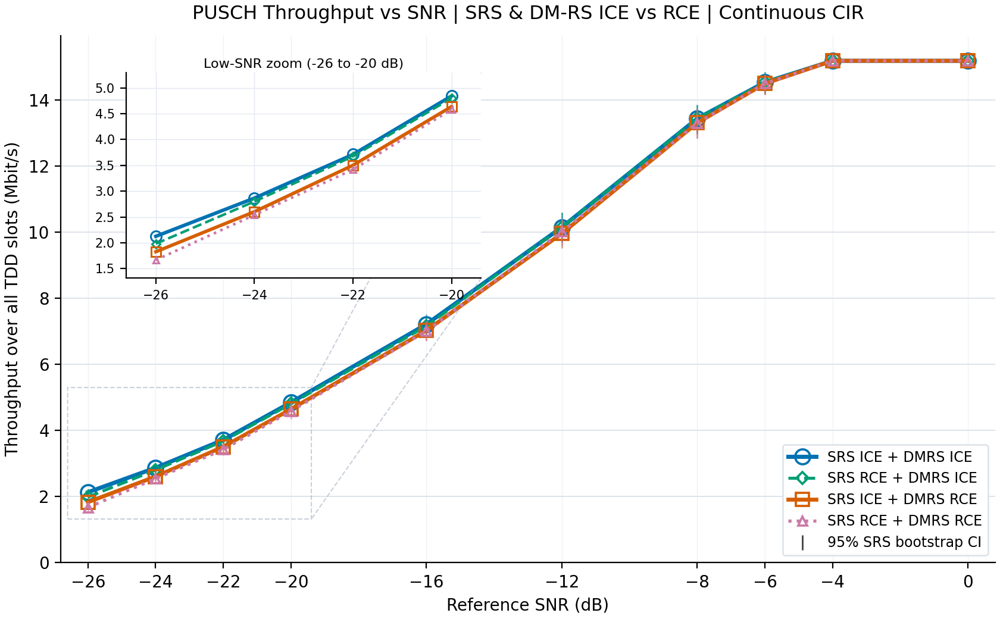
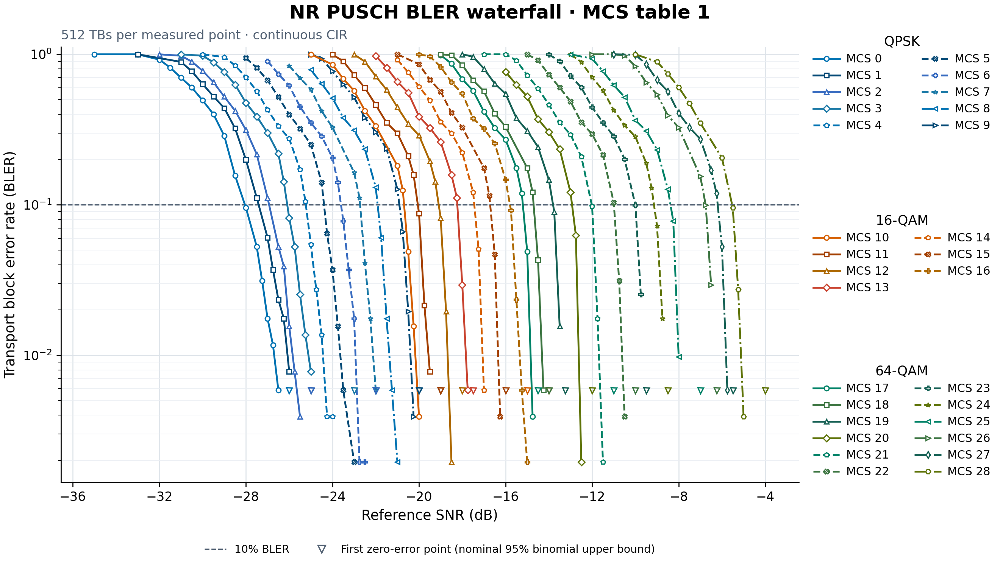
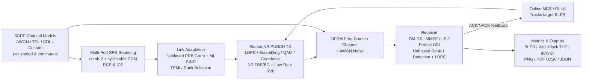

<div align="center">

# 5G NR PUSCH Link-Level Simulation Baseline

**Single-UE 5G NR CP-OFDM Uplink Link-Level Simulator Built on Sionna 1.2.2**

[简体中文](README.md) | **English**

[](https://github.com/zhangzij15/nr-pusch-baseline/actions/workflows/ci.yml)
[](pyproject.toml)
[](requirements.txt)
[](https://www.3gpp.org/dynareport/38211.htm)
[](LICENSE)

<p>
  <a href="#visual-showcase">Showcase</a> •
  <a href="#architecture-and-key-features">Architecture</a> •
  <a href="#installation">Installation</a> •
  <a href="#quick-start">Quick Start</a> •
  <a href="#channel-evolution-and-csi-prediction-api">CSI Prediction API</a> •
  <a href="#directory-structure">Directory</a> •
  <a href="#built-in-configs-and-conventions">Configs &amp; Conventions</a> •
  <a href="#faq">FAQ</a> •
  <a href="#citation">Citation</a>
</p>

</div>

---

A pure-Python **5G NR CP-OFDM uplink (PUSCH) link-level simulator** built on NVIDIA **Sionna 1.2.2** — ready to run out of the box with no MATLAB or GPU required.

Whether you are benchmarking **4T64R uplink codebook precoding**, comparing **SRS / DM-RS channel estimators (ICE vs. RCE)**, evaluating **CSI prediction** over time-varying channels, or generating **full MCS 0–28 BLER waterfalls**, this repository provides a clean, reproducible baseline. Codebook and estimator comparisons share the physical CIR, standardized SRS and PUSCH receiver noise, and common payload prefixes on each physical slot, and automatically report 95% SRS-period bootstrap throughput intervals and paired differences.

---

## Visual Showcase

Both showcase examples use **4T64R CDL-C, 48 PRBs (30 kHz SCS), `DSUDD` TDD, 6.7 GHz, 3 km/h walking speed, Rank-1 full codebook (TPMI 0–27), and `full_power` mode**, with **`--channel-evolution continuous`**.

> [!NOTE]
> The figures and table values below were archived at commit `d4b935e` (prior to the updates to the normal-CP CIR clock, unified PRB-level precoder scoring, and slot-keyed PUSCH noise pairing). The commands below run the exact same scenarios on the current simulator; exact point values will shift slightly while overall trends remain consistent.

### 1. Ideal (ICE) vs. Real (RCE) Channel Estimation Throughput

<p align="center">
  
</p>

> `ICE` assumes ideal channel knowledge, whereas `RCE` performs noisy pilot-based estimation. The four curves combine ideal and real estimation across **SRS (precoder selection)** and **DM-RS (data demodulation)** to highlight the impact of each stage.

- **Setup**: 4 TX ports share a single SRS resource (comb-2, 4 consecutive repeated symbols, orthogonal cyclic shifts `0/2/4/6`) transmitted every `S` slot (5-slot / 2.5 ms period); Rank-1 separable time-frequency DM-RS LMMSE; 10% target BLER; 240 warmup + 300 evaluation TBs (~1.35 s continuous trajectory, single drop `seed=20261112`).
- **Takeaway**: At −26 dB on this trajectory, `SRS ICE + DMRS ICE` (2.125 Mbps) leads `SRS RCE + DMRS RCE` (1.619 Mbps) by **0.507 Mbps**; switching only DM-RS to real LMMSE estimation reduces throughput by **0.299 Mbps**, while switching only SRS to real estimation reduces it by **0.178 Mbps**. As SNR increases, estimation loss diminishes and all four curves converge to the MCS 28 ceiling (**15.179 Mbps**) from −4 dB onward.

| Reference SNR | SRS ICE + DMRS ICE | SRS RCE + DMRS ICE | SRS ICE + DMRS RCE | SRS RCE + DMRS RCE |
| :---: | :---: | :---: | :---: | :---: |
| **−26 dB** | 2.125 Mbps *(11.3%)* | 1.947 Mbps *(12.0%)* | 1.826 Mbps *(11.3%)* | 1.619 Mbps *(12.7%)* |
| **−20 dB** | 4.845 Mbps *(11.3%)* | 4.791 Mbps *(11.3%)* | 4.639 Mbps *(11.3%)* | 4.555 Mbps *(11.7%)* |
| **−12 dB** | 10.143 Mbps *(11.3%)* | 10.143 Mbps *(11.3%)* | 9.953 Mbps *(11.3%)* | 9.953 Mbps *(11.3%)* |
| **−4 / 0 dB** | 15.179 Mbps *(0.0%)* | 15.179 Mbps *(0.0%)* | 15.179 Mbps *(0.0%)* | 15.179 Mbps *(0.0%)* |

> Italicized percentages in parentheses denote the measured evaluation BLER (10% target); throughput is wall-clock goodput over all TDD slots (`thp_wall_clock_mbps`).

<details>
<summary>Run the Figure 1 scenario (~25 min on a 16-core CPU)</summary>

```bash
python run_ice_rce.py --config pusch_baseline/configs/cdl_c_4t64r_codebooks_long.json --warmup-tb 240 --num-tb 300 --channel-evolution continuous --workers 16
```

> Adjust `--workers` to your physical CPU core count (numerical outputs are identical). Omitting `--snr` sweeps the built-in 10-point grid (−26 to 0 dB).

</details>

---

### 2. MCS Table 1 (MCS 0–28) BLER Waterfall

<p align="center">
  
</p>

- **Setup**: Fixed MCS 0–28 (QPSK / 16-QAM / 64-QAM) evaluated on a shared continuous channel bank of **512 continuous TBs** (~1.28 s, single drop) with `--snr-step 0.25` adaptive bisection on steep drop-offs (429 measured points), noisy 4-port SRS TPMI selection (every 5 slots), and DM-RS LMMSE. Downward triangles mark the first zero-error point per MCS (nominal 95% upper bound ~0.58%).
- **Takeaway**: All 29 curves span more than **22 dB** (−28.0 to −5.5 dB) with strictly monotonic 10% BLER knees and descend cleanly to a zero-error point; the last nonzero BLER before zero errors is at most 2.9% across the entire table (0.2%–1% on most rows). With DM-RS LMMSE, the 10% BLER thresholds are −20.89 dB for QPSK MCS 9 and −20.67 dB for 16-QAM MCS 10 — a **0.22 dB** gap with smooth modulation-boundary transition and no curve inversion.

| Representative MCS | Modulation | TBS (bits) | 10% BLER Reference SNR |
| :---: | :---: | :---: | :---: |
| **MCS 0 / 5 / 9** | QPSK | 1,672 / 5,120 / 9,224 | −28.04 / −24.37 / −20.89 dB |
| **MCS 10 / 16** | 16-QAM | 9,224 / 17,928 | −20.67 / −15.79 dB |
| **MCS 17 / 24 / 28** | 64-QAM | 17,928 / 31,240 / 37,896 | −15.18 / −9.12 / −5.52 dB |

> [!NOTE]
> Both showcase plots come from a single continuous channel realization (`seed=20261112`). For ensemble-averaged performance, sweep multiple `--seed` values and aggregate (see [Scope and Standards](#scope-and-standards)).

<details>
<summary>Run the Figure 2 scenario (checkpoint-resumable; ~80 min on a 16-core CPU)</summary>

```bash
python run_mcs_waterfall.py --num-tb 512 --snr-step 0.25 --channel-evolution continuous --workers 16
```

</details>

---

## Architecture and Key Features



| Module | Key Capabilities and Design |
| :--- | :--- |
| **Standard NR PUSCH PHY** | Native Sionna 1.2.2 uplink chain (scrambling, QAM, layer mapping, Type-I codebook precoding, DM-RS, 20-iteration LDPC) augmented with exact TS 38.214 §5.1.3.2 TBS quantization, TS 38.212 §6.2.2 explicit LDPC BG1/BG2 selection, and low-rate RV0 rate matching (QPSK–256-QAM across MCS Tables 1/2/3; full-slot single-layer 48-PRB rows and TBS/BG boundary cases bit-verified against MATLAB 5G Toolbox `nrTBS` / `nrULSCH`). |
| **Single Multi-Port Cyclic-Shift SRS** | Models TS 38.211 §6.4.1.4 and TS 38.214 §6.1.1.1: 1/2/4 TX ports share one comb-2, `B_SRS = 0`, non-hopping resource across 1/2/4 consecutive repeated symbols via orthogonal cyclic shifts (`0` / `0,4` / `0,2,4,6`), splitting total power equally ( $1 / N_{\mathrm{ap}}$ per port); both ideal (`perfect`) and noisy (`real`) SRS score precoders on 12-tone PRB-averaged Gram matrices (with noise-energy debiasing for real SRS) so RCE matches ICE in the zero-noise limit. |
| **DM-RS LMMSE & Unbiased Rank-1 Detection** | Separable time-frequency LMMSE combines an exponential power-delay profile with a Jakes Doppler prior to estimate both the channel and its error variance, alongside native LS and perfect CSI on the same channel; unbiased `RankOneDetector` scales cleanly to large receive arrays such as 64R. |
| **Continuous Cross-Period Channel Evolution** | Alongside independent per-SRS-period fading (`per_period`), `ContinuousCir` advances one mobile trajectory across warmup and measurement: built-in CDL/TDL evaluate analytically at exact TS 38.211 §5.3.1 normal-CP symbol start times (long/short CPs per 0.5 ms half-subframe) with $O(1)$ memory. |
| **Fair Pairing & Bootstrap Statistics** | Adaptive comparisons share the physical CIR, standardized SRS noise, standardized PUSCH receiver noise, and common payload prefixes per physical slot across codebooks, estimators, and SNRs, reporting 95% SRS-period bootstrap throughput CIs and paired differences. |

---

## Installation

Requires **Python 3.10 or 3.11** (compatible with TensorFlow 2.19 and Sionna 1.2.2; Python 3.12+ is not yet supported by these pinned wheels):

```bash
git clone https://github.com/zhangzij15/nr-pusch-baseline.git
cd nr-pusch-baseline
conda create -n pusch_baseline python=3.10 -y
conda activate pusch_baseline
pip install -r requirements.txt
pip install -e . --no-deps   # optional: registers the pusch-baseline CLI command
```

> [!TIP]
> **100% pure Python — no MATLAB or GPU required.** All runner scripts automatically configure TensorFlow thread pools and BLAS thread limits according to `--workers` to prevent CPU oversubscription.

---

## Quick Start

Run all commands from the **repository root** (single-line commands work identically on Linux, macOS, Windows PowerShell, and CMD). Default UTC-timestamped directories never overwrite prior runs (`./results/pusch_<stamp>/` for `python -m pusch_baseline`, and `pusch_baseline/results/` for `run_*.py`).

| Task | Entry Point | Outputs | Typical Runtime (Multi-Core CPU) |
| :--- | :--- | :--- | :---: |
| Smoke test / single-scenario run | `python -m pusch_baseline` | BLER/THP curves + CSV / JSON | ~5 s |
| 3-codebook comparison (Full / Partial / Non-coherent) | `python run_uplink.py` | 3-curve plots + paired differences | 1–10 min |
| 4-curve SRS/DM-RS ICE vs. RCE sweep | `python run_ice_rce.py` | 4-curve plots with low-SNR zoom | 2–25 min |
| Full MCS Table 1 (0–28) BLER waterfall | `python run_mcs_waterfall.py` | 29-curve waterfall (PNG + PDF, resumable) | 15–80 min |

> [!NOTE]
> Use `=` when passing SNR lists starting with a negative number (e.g., `--snr=-16,-8,0`) so the argument parser does not treat the leading minus sign as a flag.

```bash
# 1. Smoke test (~5 s)
python -m pusch_baseline --snr=-25,25 --num-tb 4 --batch-size 2

# 2. Codebook comparison (continuous CIR, custom seed)
python run_uplink.py --snr=-16,-8,0 --warmup-tb 100 --num-tb 200 --channel-evolution continuous --seed 20261112 --workers 3

# 3. SRS / DM-RS ICE vs. RCE 4-curve comparison (defaults to 10-point grid -26..0 dB if --snr omitted)
python run_ice_rce.py --snr=-26,-20,-12,-4 --warmup-tb 60 --num-tb 60 --channel-evolution continuous --workers 4

# 4. Full MCS Table 1 BLER waterfall (resumable via the same --output-dir and flags)
python run_mcs_waterfall.py --num-tb 512 --snr-step 0.25 --channel-evolution continuous --workers 16

# 5. Validate a config or run a short single-scenario OLLA trial
python -m pusch_baseline --config pusch_baseline/configs/cdl_c_4t64r.json --check
python -m pusch_baseline --config pusch_baseline/configs/cdl_c_4t64r_codebooks_long.json --snr=-12 --warmup-tb 30 --num-tb 30
```

<details>
<summary>CLI Options Quick Reference</summary>

| Option | Scripts | Description |
| :--- | :--- | :--- |
| `--config PATH` | All | JSON scenario profile |
| `--output-dir PATH` | All | Output directory (must be new, except when resuming a waterfall) |
| `--snr` / `--snr-db` | All | Override SNR list; use `=` for negative leading values (`--snr=-20,-12,-4`) |
| `--num-tb` / `--warmup-tb` | All (`--warmup-tb` on OLLA-capable scripts) | Override evaluation / warmup TB counts; auto-fits OLLA stability windows |
| `--channel-evolution` | All three `run_*.py` | `per_period` (independent per SRS period) or `continuous` (single trajectory) |
| `--tx-power-mode` | `run_uplink` / `run_ice_rce` | `full_power` (Rel-16 full power) or `per_port` (Rel-15 per-port power cap) |
| `--ue-yaw-offsets` | `run_uplink` / `run_ice_rce` | Comma-separated CDL UE yaw offsets in degrees |
| `--snr-step` / `--snr-from` | `run_mcs_waterfall` | Adaptive refinement step (`1/0.5/0.25/0.125` dB) or reuse an existing `summary.json` grid |
| `--single` | `run_uplink` | Run a single curve using the config's candidates instead of 3-codebook comparison |
| `--seed INT` | All | Override random seed (sweep multiple seeds for ensemble averaging) |
| `--workers INT` | All three `run_*.py` | Worker process count (recommended: up to physical CPU cores) |

</details>

---

## Channel Evolution and CSI Prediction API

Switch between independent per-SRS-period fading (`per_period`, default) and a single continuous physical trajectory (`continuous`) via `adaptation.channel_evolution` or `--channel-evolution`:

| Mode | Channel Behavior | Memory | Best For |
| :--- | :--- | :---: | :--- |
| **`per_period`** *(default)* | Draws fresh small-scale fading per SRS period; time-continuous within each period | $O(1)$ | Fast multi-fading averaging across channel realizations |
| **`continuous`** | Advances a single mobile trajectory across warmup and measurement; built-in CDL/TDL evaluate at exact TS 38.211 normal-CP symbol start times | $O(1)$ for built-in CDL/TDL | **CSI prediction**, time-varying tracking, mobility studies |

### Streaming Continuous SRS Observations and True PUSCH Channels

To export continuous noisy SRS estimates alongside ground-truth PUSCH frequency responses for CSI prediction algorithms:

```python
from dataclasses import replace
import numpy as np
from pusch_baseline import load_config
from pusch_baseline.adaptive_simulation import SoundingChannel, sounding_epochs
from pusch_baseline.srs import SrsEstimator

cfg = load_config("pusch_baseline/configs/cdl_c_4t64r_codebooks.json")
cfg = replace(cfg, adaptation=replace(cfg.adaptation, channel_evolution="continuous"))
srs = SrsEstimator(4, cfg.carrier.n_size_grid, cfg.adaptation.srs_sequence_id, start_symbol=10)
epochs = list(sounding_epochs(cfg.adaptation, tb_limit=20))       # DSUDD: SRS every 5 slots
# total_slots is only required for custom CIR models; built-in CDL/TDL are analytical.
stream = SoundingChannel(cfg, None, srs, total_slots=epochs[-1][-1] + 1)
rng = np.random.default_rng(cfg.sweep.seed)
snr_db = -10.0
noise_var = 10.0 ** (-snr_db / 10.0)                              # per-RE noise variance at snr_db

for epoch in epochs:
    srs_slot = epoch[0]
    # Yields the SRS pilot CFR first, followed by full-slot PUSCH CFRs in this epoch.
    slots = stream.slots(tuple(s - srs_slot for s in epoch), start_slot=srs_slot)
    pilots = np.asarray(next(slots))                              # [RX, TX, 4, M_pilot]
    h_srs_hat = srs.estimate_from_pilots(pilots, noise_var, rng)  # [K, RX, TX] noisy SRS estimate
    h_pusch_true = [np.asarray(h) for h in slots]                 # each [1, 1, RX, 1, TX, 14, K]
```

### Python API and Custom Channel Models

```python
from dataclasses import replace
from pusch_baseline import load_config, simulate
from pusch_baseline.outputs import write_results

cfg = load_config("pusch_baseline/configs/cdl_c_4t64r_codebooks.json")
cfg = replace(
    cfg,
    sweep=replace(cfg.sweep, snr_db=(-16.0, -8.0), num_tb_per_snr=40),
    adaptation=replace(cfg.adaptation, channel_evolution="continuous"),
)
run = simulate(cfg)
write_results("results/custom_run", **run, metric="both")
```

Custom external CIR models (e.g., ray-tracing or measured datasets) can be plugged in by setting `channel.kind = "custom"` and passing `channel_model_factory(cfg, resource_grid)` to `simulate()`. The returned callable takes `(batch_size, num_time_steps, sampling_frequency)` and returns complex path gains `a[B, 1, R, 1, T, P, S]` and delays `tau[B, 1, 1, P]` (or per-antenna-pair delays) in seconds. The adaptive link samples custom CIRs uniformly at `14 / slot_duration_s` and caches the custom trajectory in continuous mode.

---

## Directory Structure

```text
.
├── run_uplink.py                 # Entry 1: 3-codebook comparison (--single / --workers / --channel-evolution / --seed)
├── run_ice_rce.py                # Entry 2: 4-curve SRS/DM-RS ICE vs. RCE throughput sweep
├── run_mcs_waterfall.py          # Entry 3: MCS Table 1 BLER waterfall (resumable + sub-dB refinement)
├── README.md / README_EN.md      # Chinese / English documentation
├── LICENSE                       # MIT License
├── CITATION.cff                  # GitHub citation metadata
├── requirements.txt              # Pinned runtime dependencies
├── pyproject.toml                # Package metadata & CLI entry point
├── .github/workflows/ci.yml      # GitHub Actions CI workflow
├── docs/figures/                 # Showcase figures embedded in README
└── pusch_baseline/
    ├── __init__.py               # Public API: SimulationConfig, load_config, simulate, simulate_codebook_comparison
    ├── __main__.py               # Single-scenario CLI (python -m pusch_baseline / pusch-baseline)
    ├── config.py                 # Typed config dataclasses & strict schema validation
    ├── link.py                   # Single-UE PUSCH link wrapper (exact TS 38.214 TBS & paired noise injection)
    ├── simulation.py             # Fixed-grant sweep, codebook comparison & runtime thread configuration
    ├── adaptive_simulation.py    # Physical TDD slot timeline, SRS periodicity & closed-loop adaptation engine
    ├── continuous_channel.py     # Cross-period continuous CIR sampler & TS 38.211 normal-CP symbol clock
    ├── srs.py                    # TS 38.211 cyclic-shift multi-port SRS generation & CDM estimation
    ├── adaptation.py             # Debiased 12-tone PRB Gram & MI-based TPMI/Rank selection
    ├── dmrs_lmmse.py             # Rank-1 separable time-frequency DM-RS LMMSE estimator
    ├── rank_one_detector.py      # Unbiased Rank-1 LMMSE detector & soft demapper
    ├── low_rate_tb.py            # Explicit BG1/BG2 selection & low-rate RV0 rate-matching (QPSK–256-QAM)
    ├── olla.py                   # Online MCS-state & SINR-margin OLLA controllers
    ├── mcs_stability.py          # Three-window MCS drift & BLER stability check
    ├── throughput_statistics.py  # 95% SRS-period bootstrap CIs & paired throughput differences
    ├── outputs.py                # Single-run JSON / CSV / PNG writers
    ├── comparison_outputs.py     # 3-codebook comparison outputs & plotting
    ├── mcs_waterfall_channel.py  # Shared memmap physical channel bank with SHA-256 fingerprint
    ├── mcs_waterfall.py          # Adaptive sub-dB MCS waterfall sampler
    ├── mcs_waterfall_plot.py     # Waterfall PNG / PDF plotter
    ├── configs/                  # 7 built-in JSON scenario profiles
    └── tests/                    # Pure-Python unit test suite
```

---

## Built-in Configs and Conventions

### Built-in Profiles

| Config File | Scenario |
| :--- | :--- |
| [awgn_siso.json](pusch_baseline/configs/awgn_siso.json) | 1T1R AWGN, 24 PRBs, fixed MCS 5 (default smoke profile) |
| [tdl_2x2.json](pusch_baseline/configs/tdl_2x2.json) | 2T2R TDL-C, Rank-2 codebook precoding, 30 km/h |
| [cdl_c_4t64r.json](pusch_baseline/configs/cdl_c_4t64r.json) | 4T64R CDL-C, 51 PRBs, 6.7 GHz, 3 km/h, fixed Rank-1 grant |
| [cdl_c_4t64r_adaptive.json](pusch_baseline/configs/cdl_c_4t64r_adaptive.json) | 4T64R CDL-C, periodic SRS + threshold Rank/TPMI/MCS adaptation |
| [cdl_c_4t64r_dsudd.json](pusch_baseline/configs/cdl_c_4t64r_dsudd.json) | 4T64R CDL-C, 48 PRBs, `DSUDD` TDD + threshold adaptation |
| [cdl_c_4t64r_codebooks.json](pusch_baseline/configs/cdl_c_4t64r_codebooks.json) | **Main comparison profile**: 4T64R CDL-C, `DSUDD`, DM-RS LMMSE, online MCS control (100 warmup + 100 eval TBs) |
| [cdl_c_4t64r_codebooks_long.json](pusch_baseline/configs/cdl_c_4t64r_codebooks_long.json) | **Long high-precision sweep**: 500 warmup + 600 eval TBs, 3-window MCS stability & channel fingerprints |

### Physical Conventions and Outputs

- **Reference SNR**: Per-RX-antenna complex RE noise variance is fixed at $\sigma_n^2 = 10^{-\mathrm{SNR}_{\mathrm{dB}}/10}$ .
  - **Adaptive / codebook-comparison / waterfall modes**: Unit reference corresponds to the UE total data-RE power budget before precoding and channel.
  - **Fixed-grant mode (`adaptation=None`)**: Preserves Sionna's native convention (unit per-layer QAM energy times the TS 38.211 precoder $W$ , with actual data-RE power $\lVert W \rVert_F^2$ recorded in `metadata.pusch.effective_tx_data_re_power`, which equals 1.0 for built-in `awgn_siso`, `tdl_2x2`, and `cdl_c_4t64r`).
  - Because the 64-antenna BS adds ~18 dB array gain plus 38.901 element gain, 4T64R operating points lie at negative reference SNRs while post-combining SINR remains positive.
- **Power modes (adaptive)**:
  - `full_power` *(default)*: Normalizes PUSCH by $1 / \lVert W \rVert_F$ so total data-RE TX power is always 1 (Rel-16 `fullpower` UE without per-port derating, distinct from Mode 1 subset extensions or Mode 2 multi-SRS).
  - `per_port`: Caps each TX port at $1 / N_{\mathrm{TX}}$ (Rel-15 per-port PA split; total Rank-1 4-port power is 0.25 / 0.5 / 1.0 for non-coherent / partial-coherent / full-coherent TPMIs).
  - In both modes, SRS transmits simultaneously across all $N_{\mathrm{TX}}$ ports at $1 / N_{\mathrm{TX}}$ per active RE (total active-RE power = 1; comb-2 gives half the per-symbol energy of PUSCH, ~3 dB conservative vs. equal-symbol-power TS 38.213).
- **TDD SRS timing & phase**: SRS occupies the last $N_{\mathrm{ap}}$ symbols of the first `S` slot and each subsequent first `S` slot at least `srs_period_slots` slots later (matching TS 38.211 period $T_{\mathrm{SRS}}$ when aligned to `S`-slot spacing). Sounding results take effect before the next `U` slot (scheduling/processing delay $K_2 / N_2$ is not modeled). After warmup, measurement continues on the exact physical TDD phase; add `metadata.adaptation.measurement_start_slot` to each measurement `slot_index` to recover the physical slot counted from the start of the simulation.
- **TBS, base graph & low-rate coding**: Transport block size follows TS 38.214 §5.1.3.2 (retaining fractional $N_{\mathrm{info}}$ with round-half-up quantization), and LDPC base-graph selection follows TS 38.212 §6.2.2 using `(TBS, target_coderate)`, correcting Sionna 1.2.2 boundary discrepancies and extending RV0 rate matching below native LDPC limits.
- **BLER & throughput**: Any CRC failure or decoded bit mismatch counts as a block error. TDD wall-clock goodput (`thp_wall_clock_mbps`) divides correctly received payload bits by total elapsed physical time across all `D`, `S`, `U`, and idle slots (without HARQ combining).
- **Outputs**: High-DPI plots (`THP_vs_SNR*.png`, `BLER_vs_SNR*.png`, waterfall `.pdf`), flat CSV tables (`results.csv`, `paired_differences.csv` / `throughput_differences.csv`), and full `summary.json` records including slot traces and channel SHA-256 fingerprints.

### Running Unit Tests

```bash
python -m unittest discover -s pusch_baseline/tests -v
```

The pure-Python unit test suite covers multi-port cyclic-shift SRS orthogonality, TS 38.211 normal-CP symbol timing and `ContinuousCir`, DM-RS LMMSE, NR TBS / BG1-BG2 / low-rate RV0 bit-level MATLAB parity, cross-stage TDD phase continuity, slot-keyed PUSCH noise and payload pairing, online OLLA and 3-window stability, sub-dB waterfall refinement with short-grant slicing, and ICE/RCE outputs — verified automatically on every push via GitHub Actions CI.

---

## FAQ

<details>
<summary><b>Q1: Do I need MATLAB or a CUDA GPU?</b></summary>

No. All simulation runners and unit tests are 100% pure Python with no MATLAB dependencies and run cleanly on standard multi-core CPUs. Pass `--workers N` to scale across cores without thread contention. If dependency installation fails, verify you are using **Python 3.10 or 3.11**.

</details>

<details>
<summary><b>Q2: Why are reference SNRs negative (e.g., −26 to −4 dB) in the 4T64R figures?</b></summary>

Reference SNR is defined prior to the 64-antenna receive array (~18 dB combining gain) and 38.901 element gain. After receive combining, the effective post-equalization SINR lies in the standard 0–25 dB range.

</details>

<details>
<summary><b>Q3: Can an interrupted waterfall sweep resume without starting over?</b></summary>

Yes. `run_mcs_waterfall.py` atomically checkpoints every completed `(MCS, SNR)` point under `mcs_checkpoints/`. Within the same simulator revision, re-running with the same `--output-dir` and parameters verifies the manifest, revision, and channel fingerprint and resumes seamlessly. After an update to coding, channel timing, or precoder scoring, start a new output directory (archived results remain readable and their SNR grids can still be reused via `--snr-from`).

</details>

<details>
<summary><b>Q4: How do I evaluate my own CSI prediction or channel model?</b></summary>

- **CSI prediction**: Enable `adaptation.channel_evolution = "continuous"` and use `SoundingChannel` (see [CSI Prediction API](#channel-evolution-and-csi-prediction-api)) to stream noisy SRS estimates and future ground-truth PUSCH channels at exact OFDM symbol timestamps.
- **Custom channel model**: Set `channel.kind = "custom"` and pass `channel_model_factory` to `simulate()`, supported in both `per_period` and `continuous` modes.

</details>

---

## Scope and Standards

- **Covered**: Single UE, contiguous PRB allocation, normal CP, Mapping Type A/B starting at symbol 0, CP-OFDM, one TB per scheduled slot, first-transmission goodput.
- **Out of scope**: DFT-s-OFDM, frequency hopping, HARQ soft combining, UCI multiplexing, MU-MIMO scheduling, large-scale pathloss/shadowing, RF impairments.
- **Statistical notes**:
  - In `continuous` mode, each run evaluates one continuous mobile trajectory fixed by `sweep.seed`. Sweep multiple `--seed` values and aggregate for multi-drop ensemble averages.
  - Because adjacent SRS periods are strongly correlated in `continuous` mode, per-period bootstrap 95% CIs capture intra-trajectory temporal variability and are narrower than cross-drop ensemble CIs.
- **Standards & references**: [3GPP TS 38.211](https://www.3gpp.org/dynareport/38211.htm) · [TS 38.212](https://www.3gpp.org/dynareport/38212.htm) · [TS 38.213](https://www.3gpp.org/dynareport/38213.htm) · [TS 38.214](https://www.3gpp.org/dynareport/38214.htm) · [TR 38.901](https://www.3gpp.org/dynareport/38901.htm) · [Sionna 1.2.2 PUSCH Tutorial](https://nvlabs.github.io/sionna/v1.2.2/phy/tutorials/5G_NR_PUSCH.html).

---

## Citation

If you find this simulator useful in your research, please cite it via GitHub's **Cite this repository** button ([CITATION.cff](CITATION.cff)) or the BibTeX entry below. Released under the [MIT License](LICENSE).

```bibtex
@software{zhang2026nr_pusch_baseline,
  author  = {Zijian Zhang},
  title   = {5G NR PUSCH Link-Level Simulation Baseline},
  year    = {2026},
  version = {0.1.0},
  url     = {https://github.com/zhangzij15/nr-pusch-baseline}
}
```
