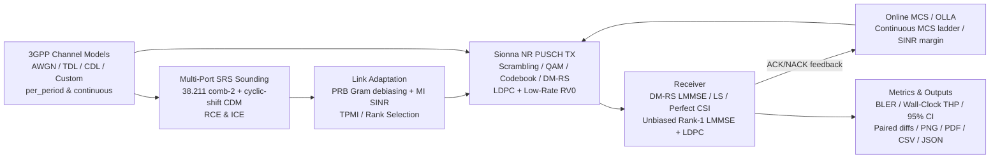

<div align="center">

# 5G NR PUSCH Link-Level Simulation Baseline

**Single-UE 5G NR CP-OFDM Uplink Link-Level Simulator Built on Sionna 1.2.2**

[简体中文](README.md) | **English**

[](https://github.com/zhangzij15/nr-pusch-baseline/actions/workflows/ci.yml)
[](pyproject.toml)
[](requirements.txt)
[](https://www.3gpp.org/dynareport/38211.htm)
[](LICENSE)

<p>
  <a href="#visual-showcase">Showcase</a> •
  <a href="#architecture-and-key-features">Architecture</a> •
  <a href="#installation">Installation</a> •
  <a href="#quick-start">Quick Start</a> •
  <a href="#channel-evolution-and-csi-prediction-api">CSI Prediction API</a> •
  <a href="#built-in-configs-and-conventions">Configs &amp; Conventions</a> •
  <a href="#citation">Citation</a>
</p>

</div>

---

A pure-Python 5G NR CP-OFDM PUSCH link-level simulator built on **Sionna 1.2.2**, focused on **4T64R uplink codebook precoding**, **SRS / DM-RS channel estimation comparisons (ICE vs. RCE)**, **continuous cross-period channel evolution for CSI prediction**, and **full MCS Table 1 (0–28) BLER waterfalls**. All sweeps use strictly paired physical CIR trajectories across SNRs, codebooks, and estimators, reporting 95% SRS-period bootstrap confidence intervals and paired throughput differences.

---

## Visual Showcase

Both figures below were generated directly by the repository scripts under **4T64R CDL-C, 48 PRBs (30 kHz SCS), `DSUDD` TDD, 6.7 GHz, 3 km/h, Rank 1 full codebook (TPMI 0–27), `full_power` mode**, with **`--channel-evolution continuous`**.

### 1. SRS & DM-RS Ideal (ICE) vs. Real (RCE) Channel Estimation Throughput

<p align="center">
  
</p>

- **Setup**: Single 4-port cyclic-shift SRS resource (comb-2, 4 repeated symbols, cyclic shifts `0/2/4/6`) transmitted every `S` slot (5-slot / 2.5 ms period), Rank-1 separable time-frequency DM-RS LMMSE, 10% target BLER, 240 warmup + 300 evaluation TBs (~1.35 s continuous trajectory, single drop `seed=20261112`).
- **Takeaway**: At −26 dB, `SRS ICE + DMRS ICE` (2.125 Mbps) outperforms `SRS RCE + DMRS RCE` (1.619 Mbps) by **0.507 Mbps** (~0.299 Mbps from DM-RS estimation error and ~0.178 Mbps from SRS estimation error; paired 95% CIs exclude zero). All four curves converge to the MCS 28 ceiling (**15.179 Mbps**) from −4 dB onward.

| Reference SNR | SRS ICE + DMRS ICE | SRS RCE + DMRS ICE | SRS ICE + DMRS RCE | SRS RCE + DMRS RCE |
| :---: | :---: | :---: | :---: | :---: |
| **−26 dB** | 2.125 Mbps *(11.3%)* | 1.947 Mbps *(12.0%)* | 1.826 Mbps *(11.3%)* | 1.619 Mbps *(12.7%)* |
| **−20 dB** | 4.845 Mbps *(11.3%)* | 4.791 Mbps *(11.3%)* | 4.639 Mbps *(11.3%)* | 4.555 Mbps *(11.7%)* |
| **−12 dB** | 10.143 Mbps *(11.3%)* | 10.143 Mbps *(11.3%)* | 9.953 Mbps *(11.3%)* | 9.953 Mbps *(11.3%)* |
| **−4 / 0 dB** | 15.179 Mbps *(0.0%)* | 15.179 Mbps *(0.0%)* | 15.179 Mbps *(0.0%)* | 15.179 Mbps *(0.0%)* |

<details>
<summary>Reproduce Figure 1 (~25 min on a 16-core CPU)</summary>

```bash
python run_ice_rce.py --config pusch_baseline/configs/cdl_c_4t64r_codebooks_long.json --warmup-tb 240 --num-tb 300 --channel-evolution continuous --workers 16
```

</details>

---

### 2. MCS Table 1 (MCS 0–28) BLER Waterfall

<p align="center">
  
</p>

- **Setup**: Fixed MCS 0–28 (QPSK / 16-QAM / 64-QAM) evaluated on a shared continuous physical channel bank of **512 continuous TBs** (~1.28 s, single drop) with `--snr-step 0.25` adaptive sub-dB refinement (429 measured `(MCS, SNR)` points), noisy 4-port SRS TPMI selection, and DM-RS LMMSE. Triangles mark the first zero-error point per MCS (nominal 95% binomial upper bound $5.8\times 10^{-3}$).
- **Takeaway**: All 29 curves drop cleanly to $10^{-2}$–$2\times 10^{-3}$ (lowest nonzero BLER $\le 2.9\%$ across every MCS) with monotonic 10% BLER knees spanning > 22 dB (−28.0 to −5.5 dB). DM-RS LMMSE eliminates LS amplitude-compression inversion: QPSK MCS 9 and 16-QAM MCS 10 are separated by only **0.22 dB** at 10% BLER.

| Representative MCS | Modulation | TBS (bits) | 10% BLER Reference SNR |
| :---: | :---: | :---: | :---: |
| **MCS 0 / 5 / 9** | QPSK | 1,672 / 5,120 / 9,224 | −28.04 / −24.37 / −20.89 dB |
| **MCS 10 / 16** | 16-QAM | 9,224 / 17,928 | −20.67 / −15.79 dB |
| **MCS 17 / 24 / 28** | 64-QAM | 17,928 / 31,240 / 37,896 | −15.18 / −9.12 / −5.52 dB |

> [!NOTE]
> Both showcase plots come from a single continuous channel realization (`seed=20261112`). For ensemble-averaged statistics, sweep multiple `--seed` values and aggregate.

<details>
<summary>Reproduce Figure 2 (checkpoint-resumable; ~80 min on a 16-core CPU)</summary>

```bash
python run_mcs_waterfall.py --num-tb 512 --snr-step 0.25 --channel-evolution continuous --workers 16
```

</details>

---

## Architecture and Key Features



- **Standard NR PUSCH PHY**: Native Sionna 1.2.2 transmitter/receiver plus an RV0 low-rate LDPC rate-matching extension covering all MCS Table 1 rows (0–28), bit-verified against MATLAB 5G Toolbox `nrULSCH`.
- **Single Multi-Port Cyclic-Shift SRS** (TS 38.211 §6.4.1.4 & TS 38.214 §6.1.1.1): 1/2/4 TX ports share one comb-2, $B_{\text{SRS}}=0$, non-hopping resource across 1/2/4 consecutive repeated symbols via orthogonal cyclic shifts (`0` / `0,4` / `0,2,4,6`) with equal per-port power $1/N_{\text{ap}}$; supports real (RCE) and ideal (`srs_estimator="perfect"`) sounding.
- **Separable Time-Frequency DM-RS LMMSE**: Exponential PDP + Jakes Doppler prior with empirical power scaling and unbiased `RankOneDetector`, alongside native LS and perfect CSI.
- **Continuous Cross-Period Channel Evolution**: `ContinuousCir` analytically evaluates Sionna CDL/TDL (and custom) trajectories at exact OFDM symbol timestamps `slot * 14 + sym` with $O(1)$ memory across warmup and measurement.
- **Strict Pairing & Bootstrap Statistics**: Identical CIR realizations and standardized SRS noise shared across SNRs, codebooks, and estimator variants, with 95% SRS-period bootstrap CIs and paired difference tables.

---

## Installation

Requires **Python 3.10 or 3.11** (compatible with TensorFlow 2.19 and Sionna 1.2.2; Python 3.12+ is not yet supported by these pinned wheels):

```bash
git clone https://github.com/zhangzij15/nr-pusch-baseline.git
cd nr-pusch-baseline
conda create -n pusch_baseline python=3.10 -y
conda activate pusch_baseline
pip install -r requirements.txt
pip install -e . --no-deps
```

> [!TIP]
> **100% pure Python — no MATLAB or GPU required.** All runner scripts automatically configure TensorFlow and BLAS thread counts according to `--workers`.

---

## Quick Start

Run all commands from the **repository root** (single-line commands work identically on Linux, macOS, Windows PowerShell, and CMD). Default timestamped output folders never overwrite previous runs (`./results/pusch_<stamp>/` for `python -m pusch_baseline`, and `pusch_baseline/results/` for `run_*.py`).

| Task | Entry Point | Typical Runtime (Multi-Core CPU) |
| :--- | :--- | :---: |
| Environment smoke test | `python -m pusch_baseline` (or `pusch-baseline`) | ~5 s |
| 3-codebook comparison (Full / Partial / Non-coherent) | `python run_uplink.py` | 1–10 min |
| 4-curve SRS/DM-RS ICE vs. RCE sweep | `python run_ice_rce.py` | 2–25 min |
| Full MCS Table 1 (0–28) BLER waterfall | `python run_mcs_waterfall.py` | 15–80 min |

> [!NOTE]
> Use `=` when passing SNR lists starting with a negative number (e.g. `--snr=-16,-8,0`).

```bash
# 1. Smoke test (~5 s)
python -m pusch_baseline --snr=-25,25 --num-tb 4 --batch-size 2

# 2. Codebook comparison (continuous CIR, custom seed)
python run_uplink.py --snr=-16,-8,0 --warmup-tb 100 --num-tb 200 --channel-evolution continuous --seed 20261112 --workers 3

# 3. SRS / DM-RS ICE vs. RCE 4-curve comparison (defaults to 10-point grid -26..0 dB if --snr omitted)
python run_ice_rce.py --snr=-26,-20,-12,-4 --warmup-tb 60 --num-tb 60 --channel-evolution continuous --workers 4

# 4. Full MCS Table 1 BLER waterfall (resumable via same --output-dir & args)
python run_mcs_waterfall.py --num-tb 512 --snr-step 0.25 --channel-evolution continuous --workers 16

# 5. Validate a config without running
python -m pusch_baseline --config pusch_baseline/configs/cdl_c_4t64r.json --check
```

---

## Channel Evolution and CSI Prediction API

Switch between independent per-SRS-period fading (`per_period`, default) and a single continuous physical trajectory (`continuous`) via `adaptation.channel_evolution` or `--channel-evolution`.

To stream continuous noisy SRS estimates alongside ground-truth PUSCH frequency responses for CSI prediction algorithms:

```python
from dataclasses import replace
import numpy as np
from pusch_baseline import load_config
from pusch_baseline.adaptive_simulation import SoundingChannel, sounding_epochs
from pusch_baseline.srs import SrsEstimator

cfg = load_config("pusch_baseline/configs/cdl_c_4t64r_codebooks.json")
cfg = replace(cfg, adaptation=replace(cfg.adaptation, channel_evolution="continuous"))
srs = SrsEstimator(4, cfg.carrier.n_size_grid, cfg.adaptation.srs_sequence_id, start_symbol=10)
epochs = list(sounding_epochs(cfg.adaptation, tb_limit=20))      # DSUDD: SRS every 5 slots
# total_slots is only required for custom CIR models; built-in CDL/TDL are analytical.
stream = SoundingChannel(cfg, None, srs, total_slots=epochs[-1][-1] + 1)
rng = np.random.default_rng(cfg.sweep.seed)
noise_var = 10.0 ** (-(-10.0) / 10.0)                            # noise variance at SNR = -10 dB

for epoch in epochs:
    srs_slot = epoch[0]
    slots = stream.slots(tuple(s - srs_slot for s in epoch), start_slot=srs_slot)
    pilots = np.asarray(next(slots))                             # [RX, TX, 4, M_pilot]
    h_srs_hat = srs.estimate_from_pilots(pilots, noise_var, rng) # [K, RX, TX] noisy SRS estimate
    h_pusch_true = [np.asarray(h) for h in slots]                # each [1, 1, RX, 1, TX, 14, K]
```

Custom external CIR models can be plugged in via `channel.kind = "custom"` and passing `channel_model_factory(cfg, resource_grid)` to `simulate()`.

---

## Built-in Configs and Conventions

- **Built-in profiles** (`pusch_baseline/configs/`): `awgn_siso.json`, `tdl_2x2.json`, `cdl_c_4t64r.json`, `cdl_c_4t64r_adaptive.json`, `cdl_c_4t64r_dsudd.json`, `cdl_c_4t64r_codebooks.json` (main), `cdl_c_4t64r_codebooks_long.json` (long sweep with 3-window MCS stability check).
- **Reference SNR**: Nominal unit UE data-RE power budget (before precoding and channel) divided by per-RX-antenna complex RE noise variance ($\sigma_n^2 = 10^{-\text{SNR}_{\text{dB}}/10}$). A 64-antenna BS adds ~18 dB array gain plus 38.901 element gain, placing operating points at negative reference SNRs.
- **Power modes**: `full_power` normalizes PUSCH by $1/\lVert W \rVert_F$ (total data-RE power = 1); `per_port` caps each TX port at $1/N_{\text{TX}}$. In both modes, SRS transmits simultaneously across all $N_{\text{TX}}$ ports at $1/N_{\text{TX}}$ per active RE (total active-RE power = 1; comb-2 gives half the per-symbol energy of PUSCH, ~3 dB conservative vs. equal-symbol-power TS 38.213).
- **TDD SRS timing**: SRS occupies the last $N_{\text{ap}}$ symbols of the first `S` slot and each subsequent first `S` slot at least `srs_period_slots` slots later (matching TS 38.211 $T_{\text{SRS}}$ when aligned to `S`-slot spacing). Sounding results are assumed available before the next `U` slot ($K_2/N_2$ delay is not modeled).
- **Tests**: Run the pure-Python suite via `python -m unittest discover -s pusch_baseline/tests -v` (also executed automatically in GitHub Actions CI).

---

## Citation

If you find this simulator useful in your research, please cite it via GitHub's **Cite this repository** button ([CITATION.cff](CITATION.cff)) or BibTeX below. Released under the [MIT License](LICENSE).

```bibtex
@software{zhang2026nr_pusch_baseline,
  author  = {Zijian Zhang},
  title   = {5G NR PUSCH Link-Level Simulation Baseline},
  year    = {2026},
  version = {0.1.0},
  url     = {https://github.com/zhangzij15/nr-pusch-baseline}
}
```
